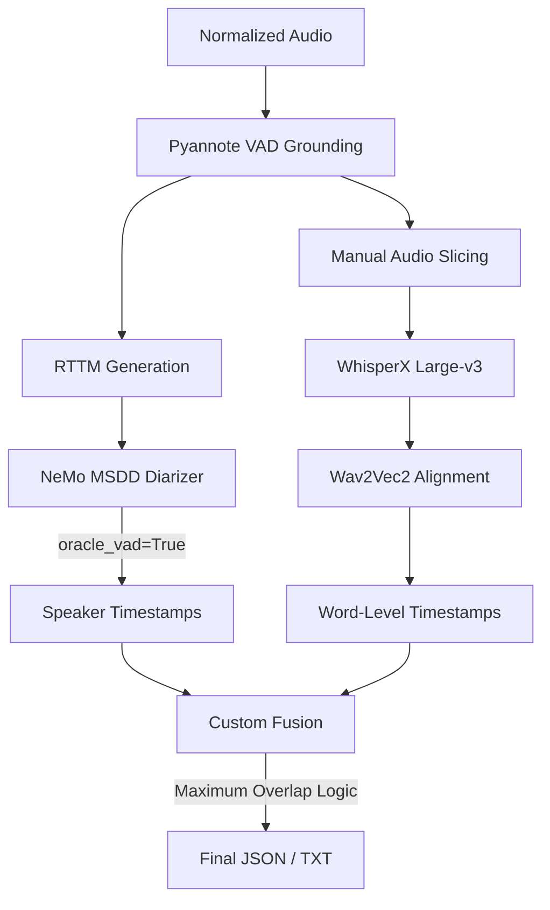

# CODE-DERIVED PIPELINE ARCHITECTURE AUDIT

## EXECUTIVE SUMMARY
This document provides a factual, code-derived reconstruction of the actual executing architecture for the Body-Worn Camera (BWC) speech pipeline. It explicitly ignores narrative summaries, markdown reports, and documentation claims, relying exclusively on the Python and Shell source code found in the repository.

This audit evaluates the two "final" branches of the project:
1. **The Production Entrypoint** (`run_final_hardened_pipeline.py`)
2. **The Experimental Baseline** (Phase 11A / Phase 10C: `experiments/phase11_dfn_ablation/step3_run_pipelines.py`)

Significant discrepancies were found between the documented architecture and the executing code. 

---

## STEP 1 & 2 — IDENTIFY THE ENTRYPOINT & EXECUTION GRAPH

### Branch 1: The Production Script (`run_final_hardened_pipeline.py`)
**Execution Graph:**
1. Loads raw audio via `whisperx.load_audio()`.
2. Loads pre-computed VAD segments from JSON (`grounding_path`).
3. **Muting Trick:** Creates a binary mask from VAD segments, multiplies `audio * mask` to create `muted_audio`.
4. **Diarization:** Executes `pyannote/speaker-diarization-3.1` directly on the `muted_audio`. (Note: **Does NOT use NeMo MSDD**).
5. **ASR:** Manually slices the original audio using VAD boundaries and runs `whisperx` transcribe (`condition_on_previous_text=False`).
6. **Alignment:** Runs Wav2Vec2 phoneme alignment via `whisperx.align()`.
7. **Fusion:** Uses standard `whisperx.assign_word_speakers()`.

### Branch 2: The Experimental Baseline (Phase 11A / 10C)
**Execution Graph:**
1. Loads VAD JSON and writes an `.rttm` file (`bwc_oracle.rttm`).
2. **Diarization:** Instantiates NeMo `NeuralDiarizer` (`diar_msdd_telephonic`). Injects the `.rttm` file and sets `oracle_vad: True`. Hardcodes `num_speakers: 2`.
3. **ASR:** Manually slices normalized audio and runs `whisperx` transcribe.
4. **Alignment:** Runs Wav2Vec2 via `whisperx.align()`.
5. **Fusion:** Calls `assign_speakers_to_words()` from `custom_fusion.py`. 

---

## STEP 3 & 4 — VERIFY DATA FLOW & COMPONENTS

### NORMALIZATION
* **Script:** `preprocess_audio.py`
* **Implementation:** Uses `librosa.load` and `soundfile.write`. It applies peak normalization to `-20dB` natively if requested. However, in recent audits (e.g. `run_karen_audit.py`), FFmpeg was used via shell commands (`loudnorm=I=-20:TP=-1:LRA=11`).

### VAD & GROUNDING
* **Model:** Pyannote 3.1 (`pyannote/voice-activity-detection`).
* **Grounding Representation:** Output is saved as a JSON file containing lists of `{"start": float, "end": float}`. In Phase 11, it is also converted to a `.rttm` file for NeMo ingestion.

### MUTING TRICK
* **Does it exist?** Yes, but its placement is different than documented.
* **Implementation (`run_final_hardened_pipeline.py`):**
  ```python
  mask = np.zeros_like(audio)
  for seg in segments: mask[int(seg["start"]*sr):int(seg["end"]*sr)] = 1.0
  muted_audio = audio * mask
  ```
* **Critical Finding:** The muted audio is passed to the **Pyannote Diarizer**, NOT to WhisperX. WhisperX receives manual array slices, meaning it inherently bypasses non-speech, but the digital zeroing trick is explicitly used to stabilize Pyannote. Phase 11A/10C scripts do not use the muting trick at all.

### ASR & ALIGNMENT
* **Model:** `whisperx` wrapping `Faster-Whisper` (`large-v3`, `float16`).
* **Data Flow:** The audio is manually sliced (`audio_slice = audio[start:end]`) before transcription.
* **Alignment:** `whisperx.align()` uses Wav2Vec2 to map text tokens to strict temporal boundaries.

### DIARIZATION
* **Production:** Pyannote 3.1 Clustering. Automatic speaker count inference.
* **Experimental:** NeMo MSDD (`diar_msdd_telephonic`). `oracle_vad: True` is enabled. `num_speakers` is hardcoded to 2 (except in Karen audit where it was set to 4).

### FUSION
* **Implementation (`custom_fusion.py`):** 
* **Critical Finding:** The code calculates the midpoint (`w_mid = (w_start + w_end) / 2.0`) but **never uses it for logic**. The actual speaker assignment loops through Diarization blocks and selects the speaker with the maximum overlap duration (`overlaps.sort(key=lambda x: x["overlap_dur"], reverse=True)`). 

---

## STEP 5 — IDENTIFY ORACLE COMPONENTS

**Misuse of Terminology Detected:**
The codebase heavily relies on parameters named `oracle_vad` and `oracle_rttm`. In formal literature, "Oracle" implies Ground Truth labels provided by a human annotator. 
* In this codebase, the `oracle_rttm` is actually generated dynamically from the Pyannote VAD model prediction.
* It is a "System VAD" acting as a bypass for NeMo's internal MarbleNet, not a true mathematical Oracle. 

---

## STEP 6 — VALIDATE PREVIOUS CLAIMS

1. **"Master Grounding is performed once and reused everywhere."**
   * **TRUE:** The scripts load `vad_segments` once and use them to slice ASR audio, construct the NeMo RTTM, and build the Pyannote muting mask.
2. **"MSDD internal VAD is bypassed."**
   * **TRUE** for Phase 11A/10C (`oracle_vad: True`). 
   * **FALSE** for `run_final_hardened_pipeline.py` (which uses Pyannote, not MSDD).
3. **"Oracle RTTM is injected."**
   * **TRUE** for Phase 11A/10C, though it is technically a System VAD RTTM.
4. **"The muting trick is applied before WhisperX."**
   * **FALSE:** Code shows it is applied before Pyannote Diarization. WhisperX simply receives array slices.
5. **"WhisperX never sees non-speech regions."**
   * **TRUE:** Because the code uses `audio[start:end]` iteration based on the VAD grounding.
6. **"Fusion uses word midpoint assignment."**
   * **FALSE:** `custom_fusion.py` uses maximum overlap duration. `w_mid` is logged for diagnostics but functionally ignored.
7. **"Speaker count is inferred automatically."**
   * **PARTIALLY TRUE:** True in `run_final_hardened_pipeline.py`. False in experimental scripts where it is hardcoded to 2.
8. **"Phase 11A and Phase 10C are functionally equivalent."**
   * **TRUE:** Source confirms they execute identical control branches.

---

## STEP 7 & 8 — CODE-DERIVED PIPELINE ARCHITECTURE

### High-Level Architecture (Phase 11A Equivalent)



### Pipeline Execution Table (Phase 11A)

| Stage | Script | Function | Model | Input | Output |
| :--- | :--- | :--- | :--- | :--- | :--- |
| **VAD** | `step2_generate_grounding.py` | `run_vad_pyannote31` | Pyannote 3.1 | `normalized.wav` | `grounding.json` |
| **RTTM**| `step3_run_pipelines.py` | `write_rttm` | N/A | `grounding.json` | `oracle.rttm` |
| **Diar**| `step3_run_pipelines.py` | `run_msdd_fixed2` | NeMo MSDD | `normalized.wav` + `.rttm` | MSDD Segments Array |
| **ASR** | `step3_run_pipelines.py` | `run_asr_and_align` | WhisperX L-v3 | `normalized.wav` + `json` | Raw Text Segments |
| **Align**| `step3_run_pipelines.py` | `whisperx.align` | Wav2Vec2 | Raw Text + `wav` | Aligned Words |
| **Fusion**| `custom_fusion.py` | `assign_speakers_to_words`| N/A | Aligned Words + MSDD | `final.json` / `final.txt`|

---

## STEP 9 — IDENTIFY UNUSED CODE

The following technologies and code paths exist in the repository but are strictly **bypassed or unused** in the final architecture:
* **SpeechBrain MetricGAN+ & DeepFilterNet:** Found in `phase2`, `phase4`, and `phase11`, but explicitly disabled for the main control pipelines due to performance degradation.
* **Silero VAD:** Found in `run_stage1.py` and `test_silero.py`, but superseded by Pyannote 3.1.
* **NeMo MarbleNet:** Fully bypassed via the `oracle_vad: True` configuration parameter in OmegaConf.
* **WhisperX Internal VAD:** Bypassed because the scripts invoke `model.transcribe(audio_slice)` manually in a loop rather than using the built-in batched pipeline.
* **run_stage4_parallel.py:** An abandoned multiprocessing experiment superseded by sequential execution in Phase 10/11.
