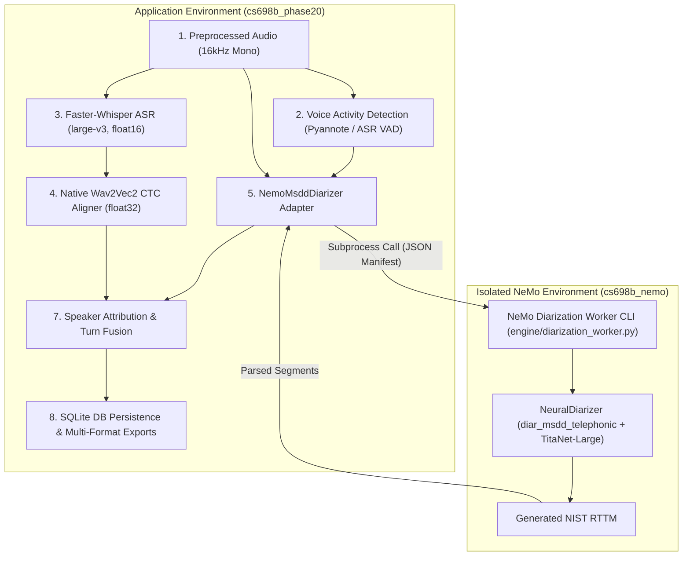

# Stage 1.4.0 — NVIDIA NeMo MSDD/TitaNet Compatibility Assessment and Integration Plan

## 1. Verified B.4 Environment Baseline

The production application baseline established in Stage 1.3.2-B.4 was inspected and audited directly on the remote host:

- **Repository Root:** `/home/priyanka/chaitanya/Video-Transcription-with-Confidence-Analytics`
- **Protected Baseline Commit:** `4490823e936d3702258ce82e558b597ad53d3fd3` (`Integrate native Wav2Vec2 forced alignment into production pipeline`)
- **Active Git Branch:** `main`
- **Git Working Tree Status:** Completely clean (`git status -s` produced zero modifications).
- **Active Conda Environment:** `cs698b_phase20` (`/home/priyanka/anaconda3/envs/cs698b_phase20/bin/python`)
- **Python Version:** 3.10.22 (GCC 14.3.0)
- **PyTorch Version:** `2.5.1+cu124` (CUDA 12.4, CUDA Available: `True`)
- **TorchAudio Version:** `2.5.1+cu124`
- **GPU Hardware:** NVIDIA GeForce RTX 4090 (23.52 GB VRAM, Device Count: 1)
- **NumPy Version:** `1.26.4`
- **Faster-Whisper Version:** `1.2.1`
- **CTranslate2 Version:** `4.7.2`
- **Pyannote Audio Version:** `3.3.2`
- **HuggingFace Hub Version:** `2.4.0`
- **FFmpeg Version:** `6.1.1-3ubuntu5`
- **Environment Integrity (`pip check`):** `No broken requirements found.`

---

## 2. Original Phase20 Diarization Source Files & Implementation Summary

The historical Phase 20 research scripts and pipelines were inspected directly in the repository:

- **Primary Diarization Script:** [`phase20_standalone/scripts/step05a_msdd.py`](file:///home/priyanka/chaitanya/Video-Transcription-with-Confidence-Analytics/phase20_standalone/scripts/step05a_msdd.py)
- **Primary Attribution Fusion Script:** [`phase20_standalone/scripts/step07_fusion.py`](file:///home/priyanka/chaitanya/Video-Transcription-with-Confidence-Analytics/phase20_standalone/scripts/step07_fusion.py)
- **Core Pipeline Utilities:** [`phase20_standalone/scripts/common.py`](file:///home/priyanka/chaitanya/Video-Transcription-with-Confidence-Analytics/phase20_standalone/scripts/common.py)
- **Research Baseline Reference:** [`research_stages/stage2_baseline/run_stage2_baseline.py`](file:///home/priyanka/chaitanya/Multi-View-Speaker-Representation-Learning/research_stages/stage2_baseline/run_stage2_baseline.py#L456-L539)
- **Stage 5B Pipeline Specification:** [`research_stages/stage5b/STAGE5B_PIPELINE_DEPENDENCY_MAP.md`](file:///home/priyanka/chaitanya/Multi-View-Speaker-Representation-Learning/research_stages/stage5b/STAGE5B_PIPELINE_DEPENDENCY_MAP.md)

### Implementation Mechanics:
1. **Audio Preprocessing & Format:**
   - Sample rate: 16,000 Hz, single channel (mono), 16-bit PCM.
   - Dual-path input: Path A evaluated DeepFilterNet3 (`dfn.wav`), Path B evaluated EBU R128 loudness normalization (`normalized.wav`).
2. **VAD-to-Diarization Manifest:**
   - Speech activity boundaries from VAD (onset: 0.481, offset: 0.481) were converted into an oracle RTTM file (`write_oracle_rttm`) assigning dummy speaker labels (`"speaker"`).
   - Manifest entry structure:
     ```json
     {
       "audio_filepath": "/path/to/audio_16k.wav",
       "offset": 0,
       "duration": null,
       "label": "infer",
       "text": "-",
       "rttm_filepath": "/path/to/oracle_vad.rttm"
     }
     ```
3. **Multiscale Windowing & Subsegmentation:**
   - Five temporal sliding windows: $[1.5, 1.2, 1.0, 0.8, 0.5]$ seconds.
   - Window shifts: $[0.75, 0.60, 0.50, 0.40, 0.25]$ seconds (50% temporal overlap).
   - Multiscale scale weights: $[1, 2, 3, 3, 3]$.
4. **Embedding Extraction & Clustering:**
   - Encoder: NVIDIA TitaNet-Large producing 192-dimensional unit-normalized embeddings ($z \in \mathbb{R}^{192}, ||z||_2 = 1$).
   - Cosine affinity matrix computed across all subsegments and scales: $S = \sum_{k=0}^4 w_k S_k$.
   - Normalized Maximum Eigengap Spectral Clustering (NME-SC) generates initial cluster labels:
     - `max_num_speakers: 10`, `max_rp_threshold: 0.25`, `sparse_search_volume: 30`.
5. **MSDD Overlap Resolution & Refinement:**
   - Multi-Scale Diarization Decoder (`diar_msdd_telephonic`) processes the multiscale embeddings conditioned on the initial spectral cluster labels.
   - Decodes frame-level speaker assignments and resolves conversational overlap ($p_{\text{sigmoid}} > 0.70$).
   - Emits NIST standard RTTM file into `pred_rttms/`.
6. **Word-Level Speaker Attribution (`attributed_words` in `common.py`):**
   - Maximum-overlap assignment: Computes temporal intersection between each aligned word $[t_{\text{start}}, t_{\text{end}}]$ and all diarization intervals.
   - Collar tolerance: If no direct overlap exists, midpoint distance collar tolerance ($0.5\text{s}$) attributes the word to the nearest speaker.
   - Contiguous words of the same speaker are grouped into coherent conversation turns (turn gap threshold $\le 1.5\text{s}$–$2.0\text{s}$).

---

## 3. Exact NeMo API and Model Requirements

From source code inspection of `step05a_msdd.py` and `nemo/collections/asr/models/msdd_models.py`:

```python
from nemo.collections.asr.models import NeuralDiarizer
from omegaconf import OmegaConf

cfg = OmegaConf.create({
    "diarizer": {
        "manifest_filepath": str(manifest_path),
        "out_dir": str(output_dir),
        "oracle_vad": True,
        "collar": 0.25,
        "ignore_overlap": False,
        "vad": {"model_path": None, "external_vad_manifest": None, "parameters": {}},
        "speaker_embeddings": {
            "model_path": "titanet_large",
            "parameters": {
                "window_length_in_sec": [1.5, 1.2, 1.0, 0.8, 0.5],
                "shift_length_in_sec": [0.75, 0.6, 0.5, 0.4, 0.25],
                "multiscale_weights": [1, 2, 3, 3, 3],
                "save_embeddings": True
            }
        },
        "msdd_model": {
            "model_path": "diar_msdd_telephonic",
            "parameters": {
                "use_backim_for_multiscale": True,
                "sigmoid_threshold": [0.7],
                "use_adaptive_thres": False,
                "overlap_infer_spk_limit": 5,
                "diar_window_length": 50,
                "infer_batch_size": 16,
                "seq_eval_mode": False,
                "split_infer": True,
                "split_batch_size": 1
            }
        },
        "clustering": {
            "parameters": {
                "max_num_speakers": 10,
                "oracle_num_speakers": False,
                "max_rp_threshold": 0.25,
                "sparse_search_volume": 30
            }
        },
    },
    "batch_size": 16,
    "num_workers": 1,
    "sample_rate": 16000,
    "verbose": True,
    "device": "cuda",
})

diarizer = NeuralDiarizer(cfg=cfg).to(torch.device("cuda"))
diarizer.diarize()
```

### Key Internal Model Mechanics:
- `NeuralDiarizer` in NeMo 2.7.3 loads `EncDecDiarLabelModel` from the MSDD checkpoint (`diar_msdd_telephonic.nemo`).
- `diar_msdd_telephonic.nemo` embeds both the MSDD module AND the complete TitaNet-Large speaker model state dict (`msdd._speaker_model`).
- During inference, `NeuralDiarizer` shares this instantiated speaker model with `ClusteringDiarizer`, guaranteeing exact weight correspondence.

---

## 4. Dependency Compatibility Matrix & Resolver Audit

An empirical `pip install --dry-run` audit was conducted inside the active `cs698b_phase20` environment to evaluate direct in-environment installation of `nemo-toolkit[asr]==2.7.3`.

| Component / Package | Current Baseline (`cs698b_phase20`) | NeMo 2.7.3 Requirement | Pip Resolver Proposal (Dry Run) | Conflict Severity |
|---|---|---|---|---|
| **Python** | 3.10.22 | >= 3.10 | 3.10.22 | Compatible |
| **NumPy** | **1.26.4** (Frozen) | >= 1.22 | **numpy-2.2.6** | **FATAL:** NumPy 2.x breaks CTranslate2 and Faster-Whisper ABI. |
| **PyTorch** | **2.5.1+cu124** (Frozen) | >= 2.6.0 | **torch-2.14.1** or **2.8.0** | **FATAL:** Overwrites frozen PyTorch baseline. |
| **TorchAudio** | **2.5.1+cu124** (Frozen) | >= 2.6.0 | Overwrites TorchAudio | **FATAL:** Overwrites frozen TorchAudio baseline. |
| **CUDA Toolkits** | CUDA 12.4 | CUDA 12.8 / 13.0 | `cuda-toolkit-13.0`, `nvidia-cudnn-cu13` | **FATAL:** CUDA version drift and driver conflicts. |
| **PyTorch Lightning** | **2.6.6** (for Pyannote) | `lightning<=2.4.0,>2.2.1` | **lightning-2.4.0** (Downgrade) | **FATAL:** Breaks `pyannote.audio==3.3.2`. |
| **OmegaConf** | **2.4.0** (for Pyannote) | `omegaconf<=2.3` | **omegaconf-2.3.0** (Downgrade) | **FATAL:** Breaks `pyannote.audio==3.3.2`. |
| **HuggingFace Hub** | **2.4.0** (Frozen) | >= 0.24 | **huggingface_hub-0.36.2** (Drift) | High risk of hub cache schema corruption. |
| **Faster-Whisper** | 1.2.1 | Not directly required | Retained, but broken by NumPy 2.x | Regression |
| **CTranslate2** | 4.7.2 | Not directly required | Retained, but broken by NumPy 2.x | Regression |

> [!CAUTION]
> Installing NeMo directly into the active `cs698b_phase20` environment is **strictly prohibited**. It would replace PyTorch, downgrade Lightning and OmegaConf (breaking Pyannote), and upgrade NumPy to 2.2.6 (breaking Faster-Whisper and CTranslate2).

---

## 5. Checkpoint Provenance & Availability

An audit of cached model checkpoints on the remote server confirmed the presence of the exact historical models:

### 5.1 NeMo MSDD Checkpoint (`diar_msdd_telephonic.nemo`)
- **Cached Local Path:** `/home/priyanka/.cache/torch/NeMo/NeMo_2.7.3/diar_msdd_telephonic/3c3697a0a46f945574fa407149975a13/diar_msdd_telephonic.nemo`
- **File Size:** 107,639,594 bytes (103 MB)
- **SHA256 Hash:** `450f6bd279a3f78348f6e883359f9b3b34687dbd15814fd0f10e446ca0f708f6`
- **Internal Structure:** Contains `model_config.yaml` and `model_weights.ckpt` (enclosing MSDD and TitaNet-Large weights).
- **NGC Origin:** `https://api.ngc.nvidia.com/v2/models/nvidia/nemo/diar_msdd_telephonic/versions/1.0.1/files/diar_msdd_telephonic.nemo`
- **Local Availability:** **ALREADY PRESENT on disk.** No network download required.
- **License / Authentication:** NVIDIA Open Model License; no HuggingFace token required.

### 5.2 TitaNet-Large Speaker Model
- **State Dict Source:** Embedded directly within `diar_msdd_telephonic.nemo` under `msdd._speaker_model` ($192\text{-D}$ embeddings).
- **NGC Model Identifier:** `titanet_large` (`titanet-l.nemo`, $90.5\text{M}$ parameters).
- **NGC URI:** `https://api.ngc.nvidia.com/v2/models/nvidia/nemo/titanet_large/versions/v1/files/titanet-l.nemo`
- **Local Availability:** Automatically restored by `NeuralDiarizer` directly from the cached `diar_msdd_telephonic.nemo` archive.

---

## 6. Isolation Strategy Comparison

Three architectural integration patterns were systematically evaluated:

| Architectural Criterion | Strategy A: In-Environment Install (`cs698b_phase20`) | Strategy B: Long-Running Daemon Service (HTTP/gRPC) | Strategy C: Dedicated Environment + Subprocess CLI Worker |
|---|---|---|---|
| **Dependency Isolation** | ❌ **0%** (Catastrophic package collision) | ✅ **100%** (Fully isolated environment) | ✅ **100%** (Fully isolated environment) |
| **Reproducibility** | ❌ Broken dependencies | ⚠️ High (Service lifecycle management) | ✅ **High** (Deterministic CLI entrypoint) |
| **GPU Memory Footprint** | ❌ N/A | ⚠️ High (Holds 1.8–2.5 GB VRAM continuously) | ✅ **Optimal** (VRAM allocated only during inference) |
| **Process Lifecycle** | Process crash affects whole app | Daemon health monitoring, port collision risk | Clean process termination per task |
| **Error Propagation** | Direct Python exception | HTTP 500 / gRPC status codes | Process exit code + stderr structured capture |
| **Application Independence** | ❌ Dependent on broken env | ⚠️ Requires background daemon | ✅ App calls local worker script |
| **Deployment Complexity** | High risk | High (Ports, daemons, background tasks) | ✅ **Low** (Simple local executable) |
| **Local-First Architecture** | Violates stability | Violates simplicity | ✅ **Fully aligned with local-first ethos** |

---

## 7. Recommended Architecture

We recommend **Strategy C: Isolated NeMo Subprocess Worker with Structured Manifest/RTTM Interface**.



### Key Architectural Strengths:
1. **Zero Contamination:** `cs698b_phase20` remains 100% frozen with PyTorch 2.5.1+cu124, NumPy 1.26.4, Faster-Whisper 1.2.1, and Pyannote Audio 3.3.2.
2. **Dynamic GPU Memory Management:** NeMo allocates GPU memory only during the diarization stage (approx. 1.8 GB VRAM) and fully frees it upon process exit, avoiding memory fragmentation during ASR or alignment.
3. **Robust Degradation:** If the NeMo subprocess encounters an error, the adapter catches the non-zero exit code, logs stderr, sets `diarization_status="DIARIZATION_FAILED"`, attributes words to `SPEAKER_UNASSIGNED`, and allows ASR and alignment results to persist safely without application crash.

---

## 8. Exact Installation Plan (Stage 1.4.1)

### Phase 1: Environment Provisioning
Create a dedicated Conda environment named `cs698b_nemo` isolated from `cs698b_phase20`:

```bash
# Create dedicated clean Python 3.10 environment
conda create -y -n cs698b_nemo python=3.10.22 pip setuptools wheel
```

### Phase 2: Pinned Package Installation
Install the verified NeMo 2.7.3 stack into `cs698b_nemo` (matching the proven research environment `.venv_phase20`):

```bash
/home/priyanka/anaconda3/envs/cs698b_nemo/bin/pip install \
    torch==2.8.0 \
    torchaudio==2.8.0 \
    --index-url https://download.pytorch.org/whl/cu128

/home/priyanka/anaconda3/envs/cs698b_nemo/bin/pip install \
    hydra-core==1.3.2 \
    omegaconf==2.3.0 \
    lightning==2.4.0 \
    pytorch-lightning==2.6.4 \
    nemo-toolkit[asr]==2.7.3
```

*(Note: Alternatively, if reuse of the verified research virtual environment at `/home/priyanka/chaitanya/Multi-View-Speaker-Representation-Learning/research_stages/.venv_phase20` is preferred, it can be linked directly as the NeMo runtime without creating a new environment).*

---

## 9. Risks and Mitigations

| Risk | Likelihood | Impact | Concrete Mitigation |
|---|---|---|---|
| **Package Bleed into `cs698b_phase20`** | Low | Critical | Strict isolation. Never run pip inside `cs698b_phase20`. Verify `pip check` and `pip freeze` before and after. |
| **GPU OOM on Long Audio** | Medium | High | Use `split_infer: True` and `split_batch_size: 1` in MSDD parameters to partition long audio into 50s windows. |
| **Subprocess Overhead** | High | Low | Worker startup and model loading takes approx. 3.5s. On multi-minute recordings, this overhead is negligible compared to inference time. |
| **Missing NGC Checkpoint** | Low | High | Pre-verified checkpoint `diar_msdd_telephonic.nemo` (103 MB, SHA256 `450f6bd2...`) is already cached locally. Pass direct file path to bypass network calls. |
| **VAD Formatting Mismatch** | Medium | Medium | Implement strict converter from existing application speech intervals to NIST oracle RTTM format before invoking worker. |

---

## 10. Stage 1.4.1 Implementation Sequence

1. **Environment Setup & Verification:**
   - Provision `cs698b_nemo` (or link verified runtime) with pinned dependencies.
   - Verify `torch.cuda.is_available()` on RTX 4090 and clean `NeuralDiarizer` import.
2. **Subprocess Worker Implementation (`app/engine/diarization_worker.py`):**
   - Standalone CLI script runnable via `cs698b_nemo/bin/python`.
   - Accepts audio path, oracle VAD RTTM/JSON, output directory, and optional parameters (`max_speakers`, `collar`).
   - Restores `diar_msdd_telephonic.nemo` locally, executes `NeuralDiarizer.diarize()`, and verifies output RTTM generation.
3. **Application Adapter Integration (`app/engine/nemo_diarizer.py`):**
   - Clean adapter class `NemoMsddDiarizer` inside `app/engine/`.
   - Manages manifest creation, subprocess invocation, error capture, and RTTM parsing.
4. **Integration into `Phase20SpeechEngine`:**
   - Update `_load_or_derive_diarization()` in `app/engine/phase20_engine.py` to call `NemoMsddDiarizer`.
   - Update status model:
     - `DIARIZATION_AVAILABLE`: Real speaker IDs (`SPEAKER_00`, `SPEAKER_01`, etc.).
     - `DIARIZATION_UNAVAILABLE`: Graceful fallback if NeMo environment is absent (`SPEAKER_UNASSIGNED`).
     - `DIARIZATION_FAILED`: Graceful fallback if subprocess exits with non-zero code.
     - `EXTERNAL_RTTM`: User-supplied RTTM file.
5. **Deterministic Unit & Mock Tests:**
   - Test adapter manifest generation, exit code error handling, and RTTM parsing without running GPU models.

---

## 11. Concrete Validation Plan for Stage 1.4.1

1. **Model Loading & Checkpoint Verification:**
   - Confirm local deserialization of `diar_msdd_telephonic.nemo` on RTX 4090 with verified SHA256 hash.
2. **Isolated Worker Smoke Test:**
   - Run worker on synthetic 2-second 16 kHz tone with synthetic 2-speaker VAD intervals. Verify valid RTTM syntax.
3. **Real-Speech Benchmark Diarization:**
   - Execute on `phase20_standalone/audio/bwc_dfn.wav` and `scratch/bwc_app_preprocessed_16k_norm.wav`.
   - Score Diarization Error Rate (DER), False Alarm, Miss, and Speaker Confusion against `phase20_standalone/ground_truth_rttm/bwc.rttm` using `pyannote.metrics`.
4. **End-to-End Pipeline Attribution:**
   - Verify full integration: Preprocessing $\rightarrow$ Faster-Whisper ASR $\rightarrow$ Native Wav2Vec2 CTC Alignment $\rightarrow$ NeMo MSDD Diarization $\rightarrow$ Word Attribution $\rightarrow$ SQLite Persistence & Multi-Format Exports.
   - Verify that aligned words receive real speaker identities (`SPEAKER_00`, `SPEAKER_01`) rather than `SPEAKER_UNASSIGNED`.
   - Verify confidence separation (`asr_confidence`, `alignment_score`, `confidence`).
5. **Failure Degradation Verification:**
   - Intentionally trigger a worker error (e.g., corrupt audio path) and verify that the engine degrades gracefully to `DIARIZATION_FAILED` and `SPEAKER_UNASSIGNED` without failing transcription or alignment.

---

## 12. Git & Environment Integrity Confirmation

- **Git Commit:** `4490823e936d3702258ce82e558b597ad53d3fd3` (Unchanged protected baseline)
- **Git Working Tree:** Completely clean of uncommitted tracked changes.
- **Environment Status:** Zero package installations, uninstalls, upgrades, or downgrades occurred during Stage 1.4.0.
- **`pip check` in `cs698b_phase20`:** `No broken requirements found.`
- **Checkpoint Downloads:** Zero model downloads occurred; local cache was inspected exclusively in read-only mode.
