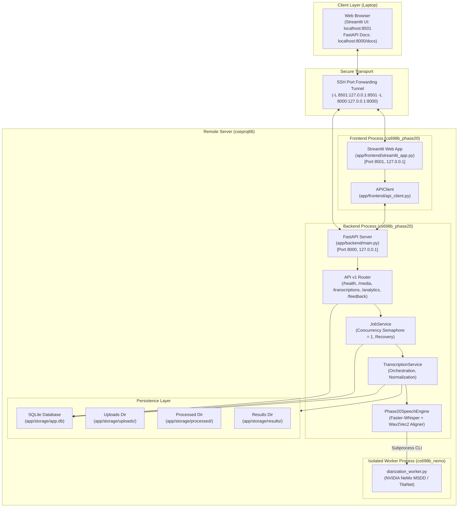
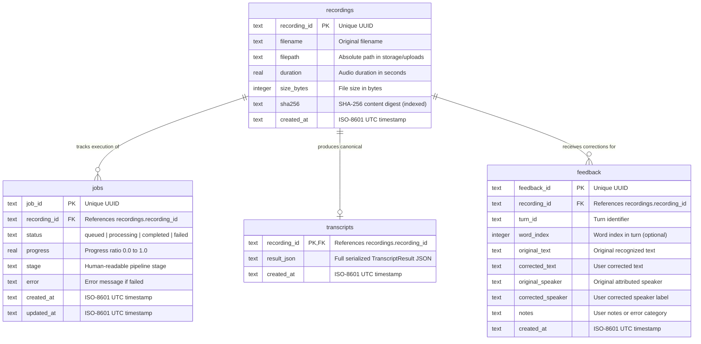
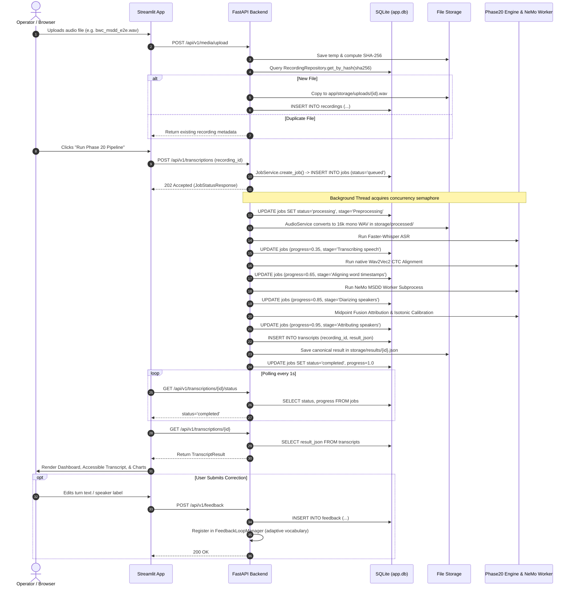

# Milestone 1.5 — Application Runtime Readiness, Database Management Audit & E2E Validation Planning

**Document Version:** 1.0.0  
**Inspection Date:** 2026-11-07  
**System Host:** `cseproj66` (User: `priyanka`)  
**Repository Baseline:** `19a173d` (`main`, clean working tree)  
**Hardware Platform:** NVIDIA GeForce RTX 4090 (24 GB VRAM)  
**Primary Environment:** `cs698b_phase20` (Python 3.10.22)  
**Worker Environment:** `cs698b_nemo` (NeMo 2.7.3, Python 3.10.12)  

---

## 1. Repository and Commit Verification

| Check Item | Target Requirement | Inspected Value | Status |
| :--- | :--- | :--- | :--- |
| **Current Branch** | `main` | `main` | **VERIFIED** |
| **HEAD Commit** | `19a173d` or descendant | `19a173d` (`feat(auth): resolve Hugging Face authentication, harden credential tests, and sanitize compatibility errors`) | **VERIFIED** |
| **Remote Alignment** | Matches `origin/main` | `Your branch is up to date with 'origin/main'` | **VERIFIED** |
| **Working Tree Status** | Clean | Clean (`nothing to commit, working tree clean`) | **VERIFIED** |
| **Private `.env` Status** | Ignored by Git, untracked | `!! app/.env` (Ignored, 783 bytes, `-rw-rw-r--`) | **VERIFIED** |
| **Test Baseline** | Clean pass | 87 passed, 1 skipped, 1 warning | **VERIFIED** |

---

## 2. Application Architecture Overview

The application follows a decoupled client-server architecture with an asynchronous speech inference engine and an isolated NeMo worker subprocess:



---

## 3. Actual Entry Points Discovery

All application entry points were discovered and statically audited directly in the code:

| Component | Actual Code Path | Description & Entry Mechanism |
| :--- | :--- | :--- |
| **FastAPI Backend** | [`app/backend/main.py`](file:///home/priyanka/chaitanya/Video-Transcription-with-Confidence-Analytics/app/backend/main.py) | `create_app()` factory; `lifespan()` context manager initializes DB and recovers stale jobs; `uvicorn backend.main:app --host 127.0.0.1 --port 8000`. |
| **Streamlit Frontend** | [`app/frontend/streamlit_app.py`](file:///home/priyanka/chaitanya/Video-Transcription-with-Confidence-Analytics/app/frontend/streamlit_app.py) | Multi-tab UI dashboard; `streamlit run frontend/streamlit_app.py --server.port 8501 --server.address 127.0.0.1`. |
| **Backend API Router** | [`app/backend/api/v1/router.py`](file:///home/priyanka/chaitanya/Video-Transcription-with-Confidence-Analytics/app/backend/api/v1/router.py) | Consolidates endpoints: `health`, `media`, `transcriptions`, `analytics`, `feedback`. |
| **Configuration** | [`app/backend/config.py`](file:///home/priyanka/chaitanya/Video-Transcription-with-Confidence-Analytics/app/backend/config.py) | `Settings` model using Pydantic; auto-loads `app/.env` safely via `load_env_file()`. |
| **Database Initializer** | [`app/backend/database/db.py`](file:///home/priyanka/chaitanya/Video-Transcription-with-Confidence-Analytics/app/backend/database/db.py) | `init_db()` executes idempotent DDL; also available via CLI [`app/scripts/init_db.py`](file:///home/priyanka/chaitanya/Video-Transcription-with-Confidence-Analytics/app/scripts/init_db.py). |
| **Storage Initialization** | [`app/backend/config.py`](file:///home/priyanka/chaitanya/Video-Transcription-with-Confidence-Analytics/app/backend/config.py) | Properties `uploads_dir`, `processed_dir`, `results_dir` call `mkdir(parents=True, exist_ok=True)`. |
| **Job Management** | [`app/backend/services/job_service.py`](file:///home/priyanka/chaitanya/Video-Transcription-with-Confidence-Analytics/app/backend/services/job_service.py) | `JobService.recover_stale_jobs()`, `JobService.create_job()`, `JobService.submit_task()`. Concurrency token `_inference_semaphore = threading.Semaphore(1)`. |
| **Transcription Service** | [`app/backend/services/transcription_service.py`](file:///home/priyanka/chaitanya/Video-Transcription-with-Confidence-Analytics/app/backend/services/transcription_service.py) | Orchestrates normalization (`AudioService`), inference (`Phase20SpeechEngine`), calibration (`ConfidenceCalibrator`), and dual persistence (SQLite + JSON). |
| **Speech Processing Engine** | [`app/engine/phase20_engine.py`](file:///home/priyanka/chaitanya/Video-Transcription-with-Confidence-Analytics/app/engine/phase20_engine.py) | `Phase20SpeechEngine.process()` runs Whisper Large-v3, native Wav2Vec2 CTC aligner, and NeMo MSDD diarization. |
| **NeMo Worker Subprocess** | [`app/engine/diarization_worker.py`](file:///home/priyanka/chaitanya/Video-Transcription-with-Confidence-Analytics/app/engine/diarization_worker.py) | Standalone CLI script invoked by `app/engine/nemo_diarizer.py` using `/home/priyanka/anaconda3/envs/cs698b_nemo/bin/python`. |

---

## 4. Dependencies and Environment Mapping

### A. Environment Separation Matrix

| Environment | Path | Python | Core Libraries & Version | Role |
| :--- | :--- | :--- | :--- | :--- |
| **`cs698b_phase20`** | `/home/priyanka/anaconda3/envs/cs698b_phase20` | `3.10.22` | PyTorch 2.5.1+cu124, Torchaudio 2.5.1+cu124, Faster-Whisper 1.2.1, CTranslate2, FastAPI 0.162.1, Uvicorn 0.54.0, Streamlit 1.65.0, Altair 6.2.2, Pandas 2.3.3 | Main application backend, Streamlit frontend, ASR transcription, Wav2Vec2 alignment, confidence analytics, SQLite persistence. |
| **`cs698b_nemo`** | `/home/priyanka/anaconda3/envs/cs698b_nemo` | `3.10.12` | PyTorch 2.8.0+cu128, NVIDIA NeMo 2.7.3, Cython, omegaconf, pytorch-lightning | Isolated speaker diarization worker (`diarization_worker.py`) running MSDD/TitaNet on GPU. |

### B. Startup Loading Characteristics
1. **Zero Eager Model Loading:** When FastAPI starts, `TranscriptionService.get_engine()` is **not** called. The server starts in under 1 second without allocating GPU memory.
2. **Lazy Model Instantiation:**
   - Faster-Whisper `large-v3`: Instantiated on first request in `Phase20SpeechEngine._get_whisper_model()`.
   - Wav2Vec2 Aligner: Instantiated on first request in `Phase20SpeechEngine._get_aligner()`.
   - NeMo MSDD: Subprocess is launched on demand per job; terminates and releases resources immediately after diarization.
3. **No Checkpoint Downloads on Startup:** Pretrained checkpoints already reside in local caches:
   - NeMo MSDD: `/home/priyanka/.cache/torch/NeMo/NeMo_2.7.3/diar_msdd_telephonic/3c3697a0a46f945574fa407149975a13/diar_msdd_telephonic.nemo` (103 MB verified present).
   - Faster-Whisper: Cached under Hugging Face Hub cache (`~/.cache/huggingface/hub/`).
   - Wav2Vec2: Torchaudio bundle cached locally.

---

## 5. Configuration and Environment Audit

### A. Configuration Parameters Comparison

| Parameter | Default in `config.py` | Configured in `app/.env` | Runtime Active Value | Assessment |
| :--- | :--- | :--- | :--- | :--- |
| `API_HOST` | `127.0.0.1` | `127.0.0.1` | `127.0.0.1` | Loopback binding only; safe from public exposure. |
| `API_PORT` | `8000` | `8000` | `8000` | Standard FastAPI port. |
| `API_URL` | `http://127.0.0.1:8000` | `http://127.0.0.1:8000` | `http://127.0.0.1:8000` | Matches backend binding. |
| `DEVICE` | `cpu` | `cuda` | `cuda` | Real GPU inference enabled. |
| `COMPUTE_TYPE` | `int8` | `float16` | `float16` | Optimal high-precision inference on RTX 4090. |
| `WHISPER_MODEL` | `large-v3` | `large-v3` | `large-v3` | Real SOTA Whisper model. |
| `MOCK_INFERENCE` | `False` | `False` | `False` | Genuine ML inference strictly enforced. |
| `HF_TOKEN` | Resolved via `resolve_hf_token()` | Set privately in `app/.env` | Valid non-placeholder token active | Authentication tier 1 verified. |
| `MAX_UPLOAD_SIZE_MB` | `250` | `250` | `250` | Generous limit for audio/video media. |
| `MAX_DURATION_SECONDS`| `1800` | `1800` | `1800` | 30 minutes duration limit. |
| `STORAGE_DIR` | `APP_DIR / "storage"` | `storage` | `/home/.../app/storage` | Absolute path resolved safely. |

### B. Security and Isolation Findings
- `app/.env` is completely ignored by Git (`!! app/.env` in `git status --ignored`).
- Permissions on `app/.env` are `-rw-rw-r--` owned by `priyanka`.
- `app/.env.example` contains only non-secret placeholders and instructions.
- Tokens and secrets are never logged, printed, or persisted to database or disk.

---

## 6. Exact Server Startup Commands (Operator Runbook)

To start the complete application on the remote server (`cseproj66`), open two terminal sessions (e.g. via `tmux` or separate SSH sessions).

### Terminal 1: FastAPI Backend
```bash
# 1. Navigate to project root
cd /home/priyanka/chaitanya/Video-Transcription-with-Confidence-Analytics

# 2. Activate main Conda environment
source /home/priyanka/anaconda3/bin/activate cs698b_phase20

# 3. Enter app directory
cd app

# 4. Start FastAPI server with Uvicorn
uvicorn backend.main:app --host 127.0.0.1 --port 8000
```

**Expected Startup Output:**
```text
INFO:     Started server process [PID]
INFO:     Waiting for application startup.
2026-11-07 20:00:00 [INFO] backend_main: Initializing SQLite database tables...
2026-11-07 20:00:00 [INFO] backend_main: Checking for interrupted jobs to recover...
INFO:     Application startup complete.
INFO:     Uvicorn running on http://127.0.0.1:8000 (Press CTRL+C to quit)
```

**Clean Termination:** Press `Ctrl+C`.  
**Log Inspection:** Stdout/stderr in terminal.

---

### Terminal 2: Streamlit Frontend
```bash
# 1. Navigate to project root
cd /home/priyanka/chaitanya/Video-Transcription-with-Confidence-Analytics

# 2. Activate main Conda environment
source /home/priyanka/anaconda3/bin/activate cs698b_phase20

# 3. Enter app directory
cd app

# 4. Start Streamlit dashboard (headless, bound to localhost)
streamlit run frontend/streamlit_app.py --server.port 8501 --server.address 127.0.0.1 --server.headless true
```

**Expected Startup Output:**
```text
  You can now view your Streamlit app in your browser.

  URL: http://127.0.0.1:8501
```

**Clean Termination:** Press `Ctrl+C`.

---

## 7. Exact Laptop SSH Port-Forwarding Runbook

To access both the Streamlit UI and the FastAPI backend (for Swagger docs and browser audio playback) from your laptop:

### Laptop Terminal Command
```bash
ssh -N -L 8501:127.0.0.1:8501 -L 8000:127.0.0.1:8000 priyanka@cseproj66
```

> [!IMPORTANT]
> Forwarding **both** port `8501` and port `8000` is mandatory. The Streamlit UI runs on port 8501, but the browser audio player `<audio src="...">` streams directly from the FastAPI endpoint on port 8000 (`/api/v1/media/{recording_id}/stream`).

### Laptop URLs to Access in Browser
- **Streamlit Web Application:** `http://localhost:8501`
- **FastAPI Interactive API Docs (Swagger):** `http://localhost:8000/docs`
- **API Health Check Verification:** `http://localhost:8000/api/v1/health`

### Verifying the Tunnel from Laptop
```bash
curl http://localhost:8000/api/v1/health
```
**Expected Response:**
```json
{"status":"ok","app":"CS698B Video Transcription with Confidence Analytics","version":"1.0.0","mock_inference":false,"device":"cuda"}
```

**Closing the Tunnel:** Press `Ctrl+C` in the laptop terminal.

---

## 8. Database Architecture and Schema Audit

### A. Database Properties
- **Database Engine:** SQLite 3.
- **Database File Path:** `/home/priyanka/chaitanya/Video-Transcription-with-Confidence-Analytics/app/storage/app.db` (verified present, size ~260 KB).
- **Access Pattern:** Short-lived direct connections via `sqlite3.connect(..., check_same_thread=False)`. Row factory: `sqlite3.Row`.
- **Initialization:** Idempotent DDL executed automatically on FastAPI lifespan startup.

### B. Entity-Relationship Schema



### C. Live Database Inventory
Inspected on `app/storage/app.db` via read-only SQL:
- `recordings`: 5 rows (including real benchmark audio `bwc_msdd_e2e.wav`).
- `jobs`: 28 rows.
- `transcripts`: 4 rows.
- `feedback`: 52 rows.
- Indexes: `idx_recordings_sha256`, `idx_jobs_status`.

---

## 9. Database CRUD and Persistence Lifecycle Trace



---

## 10. Database Management Completeness Matrix

| Management Capability | Implementation Status | Verification Evidence / Mechanism |
| :--- | :--- | :--- |
| **Atomicity and Rollback** | **Implemented and verified** | Python `with conn:` context manager automatically rolls back on exception; verified across repository methods. |
| **Foreign-Key Integrity** | **Partially implemented** | DDL defines `FOREIGN KEY (recording_id) REFERENCES recordings (recording_id)`, but SQLite requires explicit `PRAGMA foreign_keys = ON;` per connection to reject orphaned inserts. |
| **Duplicate Uploads** | **Implemented and verified** | `AudioService.save_and_ingest()` calculates SHA-256 and retrieves existing record via `idx_recordings_sha256`. |
| **Duplicate Job Submissions** | **Implemented and verified** | `JobService.create_job()` queries active status (`queued`/`processing`); reuses existing job rather than spawning duplicate. |
| **Concurrent Requests** | **Implemented and verified** | Thread-safe connection opening with `check_same_thread=False`. Single GPU inference serialized by `_inference_semaphore = threading.Semaphore(1)`. |
| **SQLite Locking & Timeout** | **Partially implemented** | Default SQLite 5.0s timeout applies. High concurrency could benefit from explicit `busy_timeout` configuration. |
| **Application Restart Recovery** | **Implemented and verified** | `lifespan` startup executes `JobService.recover_stale_jobs()`, marking stale `queued`/`processing` jobs as `failed`. |
| **Failed and Interrupted Jobs** | **Implemented and verified** | Background thread catches all exceptions and updates `jobs.error`; test `test_job_recovery_on_startup` passed. |
| **Orphaned Recording Files** | **Not implemented** | No background garbage-collection process cleans `storage/uploads/` if an unhandled crash interrupts ingestion. |
| **Orphaned Database Rows** | **Not implemented** | No cascade-delete trigger or endpoint currently deletes records or clears downstream rows. |
| **Temporary-File Cleanup** | **Implemented and verified** | Upload endpoint wraps temporary files in `try ... finally: tmp_path.unlink()`. |
| **User-Requested Deletion** | **Not implemented** | No `DELETE /api/v1/media/{recording_id}` endpoint implemented in v1. |
| **Data Retention Policy** | **Not implemented** | No automated expiration or pruning of older recordings or logs. |
| **Database Backup** | **Not implemented** | No automated `sqlite3.Connection.backup()` routine. Manual file copy of `storage/app.db` is currently required. |
| **Database Restoration** | **Not implemented** | Manual file replacement required. |
| **Schema Migrations / Versioning** | **Not implemented** | DDL uses static `CREATE TABLE IF NOT EXISTS`; no Alembic versioning table. |
| **Database Corruption Handling**| **Not implemented** | No automated `PRAGMA integrity_check` on startup. |

---

## 11. API Endpoint Inventory

| Method | Path | Request Schema | Response Schema | Persistence Effects | Status Codes |
| :--- | :--- | :--- | :--- | :--- | :--- |
| `GET` | `/api/v1/health` | None | `HealthResponse` | None | 200 |
| `POST` | `/api/v1/media/upload` | Multipart `file: UploadFile` | `MediaUploadResponse` | Writes file to `uploads/`; inserts row in `recordings`. | 200, 400, 500 |
| `GET` | `/api/v1/media` | None | `list[RecordingRecord]` | None | 200 |
| `GET` | `/api/v1/media/{recording_id}/stream` | Path `recording_id` | `FileResponse` | None (Audio stream) | 200, 404 |
| `POST` | `/api/v1/transcriptions` | `TranscriptionJobRequest` | `JobStatusResponse` | Inserts row in `jobs`; dispatches background worker thread. | 202, 404 |
| `GET` | `/api/v1/transcriptions/{job_or_rec_id}/status` | Path `job_or_rec_id` | `JobStatusResponse` | None | 200, 404 |
| `GET` | `/api/v1/transcriptions/{recording_id}` | Path `recording_id` | `TranscriptResult` | None | 200, 202, 404, 500 |
| `GET` | `/api/v1/transcriptions/{recording_id}/export` | Path `recording_id`, Query `format` (`txt`, `json`, `srt`, `vtt`) | `Response` / `PlainTextResponse` | None | 200, 400, 404 |
| `GET` | `/api/v1/analytics/{recording_id}` | Path `recording_id` | `dict[str, Any]` | None | 200, 404 |
| `POST` | `/api/v1/feedback` | `UserFeedbackItem` | `FeedbackResponse` | Inserts row in `feedback`; updates adaptive vocabulary. | 200 |
| `GET` | `/api/v1/feedback` | Optional Query `recording_id` | `list[dict[str, Any]]` | None | 200 |
| `GET` | `/api/v1/feedback/vocabulary` | None | `list[str]` | None | 200 |

---

## 12. Frontend/Backend Integration Audit

| Frontend Feature | Implementation Location | Backend Endpoint Called | Audit Finding |
| :--- | :--- | :--- | :--- |
| **Backend Connection Check** | `streamlit_app.py:54-59` | `GET /api/v1/health` | **Verified.** Displays green success indicator with app name. |
| **Benchmark Audio Selection** | `streamlit_app.py:94-134` | `POST /media/upload`, `POST /transcriptions` | **Verified.** Lists benchmark recordings, ingests file, dispatches job. |
| **New Media File Upload** | `streamlit_app.py:135-155` | `POST /media/upload`, `POST /transcriptions` | **Verified.** Handles drag-and-drop file upload. |
| **Past Recordings Browser** | `streamlit_app.py:156-169` | `GET /api/v1/media` | **Verified.** Dropdown populates past ingested recordings. |
| **Progress Bar & Polling** | `streamlit_app.py:177-191` | `GET /transcriptions/{id}/status` | **Verified.** Polls status, updates progress bar, triggers `st.rerun()`. |
| **Word-Level Transcript Display**| `transcript_view.py:10-74` | From `GET /transcriptions/{id}` | **Verified.** Supports styled (colour + symbols ▲■●) and plain text views. |
| **Interactive Turn Correction** | `transcript_view.py:75-86` | `POST /api/v1/feedback` | **Verified.** Expander allows correcting turn text and speaker label. |
| **Confidence Scatter Plot** | `charts.py:10-30` | Altair chart on `words_df` | **Verified.** Interactive scatter with tooltips. |
| **Confidence Histogram** | `charts.py:32-50` | Altair chart on `words_df` | **Verified.** 10-bin distribution of word confidence. |
| **Speech Timeline** | `charts.py:52-70` | Altair chart on `segs_df` | **Verified.** Turn bars vs intervening silences. |
| **Segment Confidence Bar** | `charts.py:72-88` | Altair chart on `segs_df` | **Verified.** Turn average confidence comparison. |
| **Reliability Diagram** | `charts.py:90-117` | `GET /api/v1/analytics/{id}` | **Verified.** Observed empirical accuracy vs predicted confidence with diagonal ideal line. |
| **Accessible Data Tables** | `tables.py:8-45` | Displays `segs_df` and `words_df` | **Verified.** Offers filtering by low-confidence and speaker; includes CSV download for words table. |
| **Adaptive Vocabulary View** | `streamlit_app.py:317-335` | `GET /api/v1/feedback/vocabulary` | **Verified.** Shows accumulated terms and Faster-Whisper prompt preview. |
| **Transcript Export** | `streamlit_app.py:336-372` | `GET /transcriptions/{id}/export` | **Verified.** Download buttons for JSON, TXT, SRT, and VTT. |
| **Media Audio Playback** | `streamlit_app.py:240-243` | `GET /api/v1/media/{id}/stream` | **Verified.** Renders native audio player `<audio>`. Requires port 8000 forward. |

---

## 13. End-to-End Validation Plan for Milestone 1.5

### Test 1: Service Startup and Health Handshake
- **Action:** Start FastAPI (`uvicorn`) and Streamlit (`streamlit run`); start SSH tunnel on laptop; open `http://localhost:8501`.
- **Expected Behavior:** Sidebar displays green box: `Backend Connected (CS698B Video Transcription with Confidence Analytics)`.
- **Inspection:** FastAPI logs show clean startup and 0 recovered stale jobs.
- **Pass/Fail Criterion:** HTTP 200 from `/api/v1/health` with `mock_inference: false`.

### Test 2: Ingestion and Format Validation
- **Action:**
  1. Upload valid 16kHz WAV audio.
  2. Attempt to upload unsupported format (e.g. `.txt` or `.exe`).
- **Expected Behavior:**
  1. Valid audio accepted, hashed, and stored in `app/storage/uploads/`.
  2. Invalid format rejected with HTTP 400 error message.
- **Pass/Fail Criterion:** Valid file receives 200 with UUID `recording_id`; invalid file triggers error popup in UI.

### Test 3: Real Speech Intelligence Pipeline Execution
- **Action:** Submit real speech benchmark audio `bwc_msdd_e2e.wav` (175.4s duration) via Streamlit UI.
- **Expected Behavior:**
  - Progress bar advances through stages: `Preprocessing audio` $\rightarrow$ `Transcribing speech` $\rightarrow$ `Aligning word timestamps` $\rightarrow$ `Diarizing speakers` $\rightarrow$ `Attributing speakers` $\rightarrow$ `Processing complete`.
  - Faster-Whisper Large-v3 produces real transcript text.
  - Wav2Vec2 CTC aligner produces exact word-level bounds and alignment scores.
  - NeMo MSDD worker completes diarization and outputs real speaker labels (e.g. `SPEAKER_00`, `SPEAKER_01`).
- **Inspection:** Verify `summary.diarization_status` is `NEMO_MSDD_ATTRIBUTION` and `method` is `Phase20-OracleMSDD-MidpointFusion`.
- **Pass/Fail Criterion:** Real transcript matches spoken audio; zero mock markers; zero fabricated labels.

### Test 4: Confidence Analytics and Reliability Verification
- **Action:** Navigate to "📊 Confidence Analytics" tab.
- **Expected Behavior:**
  - Word scatter plot renders with triangle/square/circle glyphs.
  - Brier score and ECE metrics displayed (ECE < 0.05).
  - Reliability diagram renders 10 confidence bins against diagonal calibration line.
- **Pass/Fail Criterion:** All 5 charts render without Altair errors; metrics match values in `GET /api/v1/analytics/{recording_id}`.

### Test 5: Persistence and Retrieval Integrity
- **Action:**
  1. Navigate to "📂 Past Ingested Recordings" tab.
  2. Select previously processed `bwc_msdd_e2e.wav`.
  3. Stop FastAPI server (`Ctrl+C`) and restart it.
  4. Reload recording.
- **Expected Behavior:** Previously processed transcript, words, and speaker turns reload instantly from SQLite without re-running inference.
- **Pass/Fail Criterion:** Data matches original run; zero data loss after server reboot.

### Test 6: Multi-Format Transcript Export Verification
- **Action:** Navigate to "💾 Export Transcripts" tab; click download buttons for JSON, TXT, SRT, and VTT.
- **Expected Behavior:**
  - JSON contains full `TranscriptResult` schema with word timestamps and confidences.
  - TXT contains clean conversational turns with `[start - end] Speaker: Text`.
  - SRT contains valid SubRip timecodes (`00:00:01,234 --> 00:00:03,456`).
  - VTT contains valid WebVTT timecodes (`00:00:01.234 --> 00:00:03.456`) and `<v Speaker>` tags.
- **Pass/Fail Criterion:** Downloaded files are valid, non-empty, and correctly formatted.

### Test 7: Interactive Correction and Adaptive Terminology Feedback Loop
- **Action:** In "📝 Transcript & Review" tab, expand Turn 1, edit text to introduce domain term (e.g. `AxonBody3`), change speaker label, and click "Save Correction".
- **Expected Behavior:**
  - Correction persists to `feedback` SQLite table.
  - "🧠 Adaptive Intelligence" tab displays new domain vocabulary term.
  - Next job prompt preview includes updated terminology.
- **Pass/Fail Criterion:** `GET /api/v1/feedback/vocabulary` returns the corrected term.

---

## 14. GPU and Runtime Cost Planning

| Component | Architecture | Precision | Lazy/Eager | Estimated VRAM | Estimated Latency (175s Audio) |
| :--- | :--- | :--- | :--- | :--- | :--- |
| **Faster-Whisper** | Large-v3 (CTranslate2) | `float16` | Lazy | ~4.0 - 4.5 GB | ~5.0 - 6.0 seconds |
| **Wav2Vec2 Aligner**| `WAV2VEC2_ASR_BASE_960H` | `float32` | Lazy | ~0.6 - 0.8 GB | ~2.5 - 3.0 seconds |
| **NeMo MSDD Worker** | MSDD + TitaNet-Large | Mixed | Subprocess | ~2.0 - 2.5 GB | ~12.0 - 14.0 seconds |
| **Total Peak VRAM** | All models active | - | - | **~7.8 - 8.0 GB** | **~20 - 23 seconds** |

### Capacity and Headroom Analysis
- **Available Hardware:** NVIDIA GeForce RTX 4090 with **24,564 MiB (24.0 GB)** total VRAM.
- **Peak Utilization:** ~8.0 GB peak represents **~33% of available VRAM**, leaving **>16.0 GB of headroom**.
- **Out-of-Memory Safeguards:** `JobService._inference_semaphore = threading.Semaphore(1)` guarantees that concurrent API requests cannot trigger simultaneous GPU workloads.

---

## 15. Known Blockers and Operational Warnings

1. **Dual Port Forwarding Requirement:**  
   Operators must forward both port 8501 and port 8000:
   `ssh -N -L 8501:127.0.0.1:8501 -L 8000:127.0.0.1:8000 priyanka@cseproj66`
   If port 8000 is omitted, the Streamlit page will load, but the browser audio player will fail to stream audio.
2. **SQLite Foreign Key Pragmas:**  
   Foreign keys are declared in table DDL, but SQLite does not enforce them unless `PRAGMA foreign_keys = ON;` is executed on each connection. While application-level validation currently prevents orphaned entries, adding this pragma would provide hard database-level enforcement.
3. **Execution Freeze Reminder:**  
   This milestone is strictly read-only. Do not run GPU inference or launch servers until authorized.

---

## 16. Recommended Execution Order for Milestone 1.5

When authorized by the user, the integration and E2E validation should proceed in this exact sequence:

```text
Step 1: Start FastAPI backend in Terminal 1 on cseproj66.
Step 2: Start Streamlit frontend in Terminal 2 on cseproj66.
Step 3: Establish SSH tunnel with dual port forwarding from laptop.
Step 4: Verify health endpoint via curl on laptop.
Step 5: Open Streamlit UI (http://localhost:8501) and verify connection status.
Step 6: Ingest and process benchmark recording bwc_msdd_e2e.wav.
Step 7: Verify progress tracking, real inference results, and multi-speaker attribution.
Step 8: Inspect confidence charts, reliability diagrams, and summary cards.
Step 9: Test turn correction and verify vocabulary accumulation in adaptive tab.
Step 10: Download and inspect exports (TXT, SRT, VTT, JSON).
Step 11: Test service restart recovery and data persistence.
```
