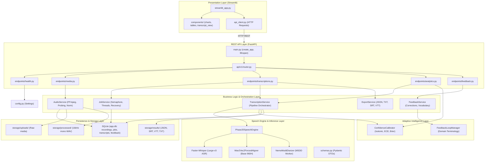
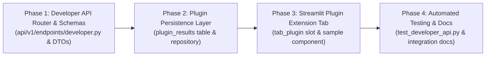

# Stage 1.6.0 — API & Repository Reconnaissance Report
## Read-Only Forensic Audit, Capability Mapping, and Developer API Planning

**Document Identifier:** `STAGE-1.6.0-RECONNAISSANCE-REPORT`  
**Date:** 2026-11-09  
**Host:** `cseproj66`  
**Repository Path:** `/home/priyanka/chaitanya/Video-Transcription-with-Confidence-Analytics`  
**Application Path:** `/home/priyanka/chaitanya/Video-Transcription-with-Confidence-Analytics/app`  
**Primary Conda Environment:** `cs698b_phase20` (Python 3.10.22)  
**GPU Hardware:** NVIDIA GeForce RTX 4090 (24 GB VRAM)  
**Audit Scope:** Read-Only Forensic Audit, OpenAPI & Capability Mapping, Schema Contract Decoupling, Persistence & Security Assessment, and Stage 1.6.1 Developer API Contract Design.

---

## 1. Executive Summary

Stage 1.6.0 conducts a comprehensive, read-only forensic audit and architectural reconnaissance of the **CS698B Video Transcription with Confidence Analytics / Conversational Intelligence Platform**. 

The primary objective is to evaluate the existing application structure, catalog all exposed REST API routes, verify data models and schema contracts, audit SQLite persistence and security posture, and plan a developer-friendly API that will allow another student team in the course to integrate their conversational intelligence / analytics plugin **directly inside our host application** (FastAPI backend + Streamlit frontend).

### Key Audit Findings

1. **Clean Modular Architecture:** The application is self-contained entirely within [app/](file:///home/priyanka/chaitanya/Video-Transcription-with-Confidence-Analytics/app). It features clean 6-layer separation: Presentation (Streamlit), REST API (FastAPI), Business Services, Engine & Speech Inference, Adaptive Confidence, and SQLite / Filesystem Persistence.
2. **Rich Canonical Data Contracts:** The speech processing pipeline produces rich, structured models defined in [schemas.py](file:///home/priyanka/chaitanya/Video-Transcription-with-Confidence-Analytics/app/engine/schemas.py), specifically [`TranscriptResult`](file:///home/priyanka/chaitanya/Video-Transcription-with-Confidence-Analytics/app/engine/schemas.py#L55-L68), [`ConversationTurn`](file:///home/priyanka/chaitanya/Video-Transcription-with-Confidence-Analytics/app/engine/schemas.py#L35-L44), and [`AlignedWord`](file:///home/priyanka/chaitanya/Video-Transcription-with-Confidence-Analytics/app/engine/schemas.py#L20-L33). These include word-level timestamps, speaker attribution, raw acoustic likelihoods, calibrated confidence scores, CTC alignment scores, and calibration metadata.
3. **Confirmed Decoupling of `recording_id` vs. `job_id`:** Forensic inspection of the live SQLite database confirms that historical recordings (such as baseline `b1b3f780-94e9-490d-89f8-52945b84b31b`) have completed entries in `transcripts` but **zero rows** in `jobs`. Decoupling `recording_id` (persistent media asset) from `job_id` (ephemeral task execution) is strictly verified and must be preserved across any third-party plugin integration.
4. **Current Route Inventory:** FastAPI exposes 13 distinct route operations under `/api/v1` and `/`. Core capabilities (media upload, audio streaming, transcription triggering, transcript retrieval, multi-format export, confidence analytics, feedback) are functional and active.
5. **Architectural Gaps for Plugin Integration:**
   - **Ambiguous Polling Route:** `/api/v1/transcriptions/{job_or_rec_id}/status` attempts dual-lookup across jobs and recordings, risking confusion for third-party developers.
   - **Untyped Analytics Response:** `/api/v1/analytics/{recording_id}` returns untyped `dict[str, Any]` rather than a formalized Pydantic response model.
   - **No Plugin Namespace:** There is currently no dedicated plugin registration, manifest discovery, or plugin result execution API.
   - **No Plugin Storage Isolation:** Without dedicated storage (e.g., a `plugin_results` table), plugin analytical outputs would pollute the canonical transcript schema.
   - **Hardcoded Frontend Tabs:** The Streamlit UI in [streamlit_app.py](file:///home/priyanka/chaitanya/Video-Transcription-with-Confidence-Analytics/app/frontend/streamlit_app.py) hardcodes five tabs with no dynamic extension slot or component mounting point for plugins.
   - **Zero Authentication / Wide-Open CORS:** CORS permits `allow_origins=["*"]` with credentials enabled, and all `/api/v1` endpoints are unauthenticated.
6. **Read-Only Verification:** Zero application files were modified, zero commits or pushes were made, and no database mutations occurred during this audit (`PRAGMA integrity_check` verified `ok`).

---

## 2. Initial Git State & Environment Baseline

A strict read-only inspection of the repository workspace verified clean status with no uncommitted changes prior to report generation:

```bash
$ git status --short --branch
## main...origin/main

$ git branch --show-current
main

$ git rev-parse HEAD
36e2f966d08dbbd5897649bf16d175e61209ace8

$ git log -n 5 --oneline --decorate
36e2f96 (HEAD -> main, origin/main, origin/HEAD) Stage 1.5.2.1 Verification and Validation
27e20b3 Stage 1.5.2 Implementation
51f8278 added documention
19a173d feat(auth): resolve Hugging Face authentication, harden credential tests, and sanitize compatibility errors
580ea83 Stage 1.4.1.1 Implementation & Verification
```

### Remote Environment Metadata

| Parameter | Specification | Verification Method |
| :--- | :--- | :--- |
| **Host** | `cseproj66` | Verified via environment inspection |
| **Repository Root** | `/home/priyanka/chaitanya/Video-Transcription-with-Confidence-Analytics` | Git working directory |
| **Application Root** | `/home/priyanka/chaitanya/Video-Transcription-with-Confidence-Analytics/app` | Standalone deployable directory |
| **Active Python** | Python 3.10.22 (`/home/priyanka/anaconda3/envs/cs698b_phase20/bin/python`) | Conda environment `cs698b_phase20` |
| **Database Path** | `/home/priyanka/chaitanya/Video-Transcription-with-Confidence-Analytics/app/storage/app.db` | SQLite 3.45.3 |
| **GPU Accelerator** | NVIDIA GeForce RTX 4090 (24 GB VRAM) | Verified via PyTorch CUDA detection |

---

## 3. Repository Architecture & Layering Reconnaissance

The application follows a modular, local-first architecture self-contained within [app/](file:///home/priyanka/chaitanya/Video-Transcription-with-Confidence-Analytics/app). All application code imports from top-level packages within `app/` (`backend`, `engine`, `adaptive`, `frontend`), ensuring independence from legacy root files.

### Architectural Layering



### Application Entry Points

1. **FastAPI Backend Entry Point:**
   - File: [app/backend/main.py](file:///home/priyanka/chaitanya/Video-Transcription-with-Confidence-Analytics/app/backend/main.py#L29-L64)
   - Function: [`create_app() -> FastAPI`](file:///home/priyanka/chaitanya/Video-Transcription-with-Confidence-Analytics/app/backend/main.py#L29-L61)
   - Lifecycle: Lifespan context manager runs [`init_db()`](file:///home/priyanka/chaitanya/Video-Transcription-with-Confidence-Analytics/app/backend/database/db.py#L18-L69) and [`JobService.recover_stale_jobs()`](file:///home/priyanka/chaitanya/Video-Transcription-with-Confidence-Analytics/app/backend/services/job_service.py#L22-L29).
   - Execution command: `uvicorn backend.main:app --host 127.0.0.1 --port 8000`
2. **Streamlit Frontend Entry Point:**
   - File: [app/frontend/streamlit_app.py](file:///home/priyanka/chaitanya/Video-Transcription-with-Confidence-Analytics/app/frontend/streamlit_app.py#L1-L445)
   - UI Architecture: Sidebar controls + Ingestion/Selection + 5 Main Dashboard Tabs ([`tab_tx`, `tab_charts`, `tab_data`, `tab_adaptive`, `tab_export`](file:///home/priyanka/chaitanya/Video-Transcription-with-Confidence-Analytics/app/frontend/streamlit_app.py#L318-L324)).
   - Execution command: `streamlit run frontend/streamlit_app.py --server.port 8501`
3. **Database Schema Initialization Entry Point:**
   - File: [app/backend/database/db.py](file:///home/priyanka/chaitanya/Video-Transcription-with-Confidence-Analytics/app/backend/database/db.py#L18-L69)
   - Function: [`init_db()`](file:///home/priyanka/chaitanya/Video-Transcription-with-Confidence-Analytics/app/backend/database/db.py#L18-L69)
   - Execution: Automatic at FastAPI startup, or via `python -m backend.database.db`.

### Coupling and Separation Analysis

- **API vs. Business Logic:** Cleanly separated. Endpoints in `app/backend/api/v1/endpoints/` do not contain heavy logic; they delegate directly to services (`AudioService`, `JobService`, `TranscriptionService`, `ExportService`, `FeedbackService`).
- **Engine vs. API:** The speech processing pipeline in `app/engine/` is completely decoupled from FastAPI. It implements [`BaseSpeechEngine`](file:///home/priyanka/chaitanya/Video-Transcription-with-Confidence-Analytics/app/engine/base.py#L10-L24) and accepts local file paths and parameter dictionaries, returning standardized [`TranscriptResult`](file:///home/priyanka/chaitanya/Video-Transcription-with-Confidence-Analytics/app/engine/schemas.py#L55-L68) objects.
- **Frontend vs. Backend:** Streamlit code never imports database models or backend services directly. All interactions flow through [`APIClient`](file:///home/priyanka/chaitanya/Video-Transcription-with-Confidence-Analytics/app/frontend/api_client.py#L8-L95) over HTTP.

---

## 4. FastAPI Route & OpenAPI Audit

FastAPI exposes an OpenAPI 3.1.0 schema extracted dynamically from `backend.main:app`. The route registry comprises 13 distinct endpoint operations across 5 functional routers and 1 root route.

### Complete Route Inventory Table

| HTTP Method | Route Path | Function Name & File | Request Schema / Params | Response Schema | Auth / Security | Status Codes | Plugin Relevance & Access Level |
| :--- | :--- | :--- | :--- | :--- | :--- | :--- | :--- |
| `GET` | `/api/v1/health` | [`health_check`](file:///home/priyanka/chaitanya/Video-Transcription-with-Confidence-Analytics/app/backend/api/v1/endpoints/health.py#L11-L19) | None | `dict[str, str \| bool]` | None (Open) | 200 | **High:** Plugin health checks and engine availability verification. |
| `POST` | `/api/v1/media/upload` | [`upload_media`](file:///home/priyanka/chaitanya/Video-Transcription-with-Confidence-Analytics/app/backend/api/v1/endpoints/media.py#L17-L47) | `multipart/form-data` (`file`) | [`MediaUploadResponse`](file:///home/priyanka/chaitanya/Video-Transcription-with-Confidence-Analytics/app/engine/schemas.py#L72-L80) | None (Open) | 200, 400, 500 | **Medium:** Host handles ingest; plugin may receive resulting `recording_id`. |
| `GET` | `/api/v1/media` | [`list_recordings`](file:///home/priyanka/chaitanya/Video-Transcription-with-Confidence-Analytics/app/backend/api/v1/endpoints/media.py#L50-L63) | None | `list[dict]` | None (Open) | 200 | **High:** Allows plugin to enumerate available recordings for batch analysis. |
| `GET` | `/api/v1/media/{recording_id}/stream` | [`stream_media`](file:///home/priyanka/chaitanya/Video-Transcription-with-Confidence-Analytics/app/backend/api/v1/endpoints/media.py#L67-L75) | Path: `recording_id` (str) | `FileResponse` (`audio/wav`, `audio/mpeg`) | None (Open) | 200, 404 | **High:** Critical for plugin audio playback, time-scrubbing, and audio-visual sync. |
| `POST` | `/api/v1/transcriptions` | [`trigger_transcription`](file:///home/priyanka/chaitanya/Video-Transcription-with-Confidence-Analytics/app/backend/api/v1/endpoints/transcriptions.py#L17-L59) | Body: [`TranscriptionJobRequest`](file:///home/priyanka/chaitanya/Video-Transcription-with-Confidence-Analytics/app/engine/schemas.py#L82-L88) | [`JobStatusResponse`](file:///home/priyanka/chaitanya/Video-Transcription-with-Confidence-Analytics/app/engine/schemas.py#L90-L99) | None (Open) | 202, 404 | **Low:** Host manages transcription execution. Plugins typically consume completed results. |
| `GET` | `/api/v1/transcriptions/{job_or_rec_id}/status` | [`get_job_status`](file:///home/priyanka/chaitanya/Video-Transcription-with-Confidence-Analytics/app/backend/api/v1/endpoints/transcriptions.py#L63-L80) | Path: `job_or_rec_id` (str) | [`JobStatusResponse`](file:///home/priyanka/chaitanya/Video-Transcription-with-Confidence-Analytics/app/engine/schemas.py#L90-L99) | None (Open) | 200, 404 | **Medium:** Polling transcription tasks. Ambiguous dual parameter lookup needs refactoring. |
| `GET` | `/api/v1/transcriptions/{recording_id}` | [`get_transcript`](file:///home/priyanka/chaitanya/Video-Transcription-with-Confidence-Analytics/app/backend/api/v1/endpoints/transcriptions.py#L84-L96) | Path: `recording_id` (str) | [`TranscriptResult`](file:///home/priyanka/chaitanya/Video-Transcription-with-Confidence-Analytics/app/engine/schemas.py#L55-L68) | None (Open) | 200, 202, 404, 500 | **Core / Essential:** Primary data ingestion endpoint for plugins (words, turns, speakers, scores). |
| `GET` | `/api/v1/transcriptions/{recording_id}/export` | [`export_transcript`](file:///home/priyanka/chaitanya/Video-Transcription-with-Confidence-Analytics/app/backend/api/v1/endpoints/transcriptions.py#L100-L121) | Query: `format` (`txt`, `json`, `srt`, `vtt`) | `Response` / `PlainTextResponse` | None (Open) | 200, 404 | **Medium:** Export formatted outputs or subtitles alongside plugin insights. |
| `GET` | `/api/v1/analytics/{recording_id}` | [`get_analytics`](file:///home/priyanka/chaitanya/Video-Transcription-with-Confidence-Analytics/app/backend/api/v1/endpoints/analytics.py#L14-L52) | Path: `recording_id` (str) | Untyped `dict[str, Any]` | None (Open) | 200, 404 | **Core / Essential:** Returns ECE, Brier score, tier breakdown, reliability diagram data. |
| `POST` | `/api/v1/feedback` | [`submit_feedback`](file:///home/priyanka/chaitanya/Video-Transcription-with-Confidence-Analytics/app/backend/api/v1/endpoints/feedback.py#L14-L22) | Body: [`UserFeedbackItem`](file:///home/priyanka/chaitanya/Video-Transcription-with-Confidence-Analytics/app/engine/schemas.py#L101-L112) | [`FeedbackResponse`](file:///home/priyanka/chaitanya/Video-Transcription-with-Confidence-Analytics/app/engine/schemas.py#L114-L117) | None (Open) | 200 | **High:** Allows plugins to submit corrections, speaker adjustments, or user annotations. |
| `GET` | `/api/v1/feedback` | [`list_feedback`](file:///home/priyanka/chaitanya/Video-Transcription-with-Confidence-Analytics/app/backend/api/v1/endpoints/feedback.py#L25-L28) | Query: `recording_id` (Optional) | `list[dict]` | None (Open) | 200 | **Medium:** Review history of user corrections for a recording. |
| `GET` | `/api/v1/feedback/vocabulary` | [`get_verified_vocabulary`](file:///home/priyanka/chaitanya/Video-Transcription-with-Confidence-Analytics/app/backend/api/v1/endpoints/feedback.py#L31-L33) | None | `list[str]` | None (Open) | 200 | **High:** Domain glossary extraction useful for plugin NLP, NER, and topic modeling. |
| `GET` | `/` | [`root`](file:///home/priyanka/chaitanya/Video-Transcription-with-Confidence-Analytics/app/backend/main.py#L53-L60) | None | `dict[str, str]` | None (Open) | 200 | **Low:** System root info. |

---

## 5. API Contract & Schema Audit

All core schemas are defined using Pydantic v2 in [app/engine/schemas.py](file:///home/priyanka/chaitanya/Video-Transcription-with-Confidence-Analytics/app/engine/schemas.py).

### Core Data Models

1. [`AlignedWord`](file:///home/priyanka/chaitanya/Video-Transcription-with-Confidence-Analytics/app/engine/schemas.py#L20-L33): Represents an individual recognized word with precise acoustic timestamps and multi-dimensional confidence.
   - `word`: string token (e.g. `"Highway"`).
   - `start`, `end`: float timestamps in seconds.
   - `speaker`: diarized speaker label (e.g. `"SPEAKER_00"`).
   - `confidence`: calibrated confidence score in $[0.0, 1.0]$.
   - `raw_confidence`: uncalibrated Whisper sequence probability in $[0.0, 1.0]$.
   - `is_calibrated`: boolean flag indicating whether calibration was applied.
   - `alignment_status`: `"aligned"` | `"unaligned"` | `"fallback"`.
   - `alignment_score`: Wav2Vec2 CTC acoustic alignment score in $[0.0, 1.0]$ (optional).
   - `asr_confidence`: Faster-Whisper sequence likelihood probability in $[0.0, 1.0]$ (optional).
   - `features`: [`ConfidenceFeatures`](file:///home/priyanka/chaitanya/Video-Transcription-with-Confidence-Analytics/app/engine/schemas.py#L8-L18) containing acoustic score, duration, speech ratio, overlap detection, and energy level.
2. [`ConversationTurn`](file:///home/priyanka/chaitanya/Video-Transcription-with-Confidence-Analytics/app/engine/schemas.py#L35-L44): Represents a contiguous speaker turn.
   - `turn_id`: unique turn identifier string (e.g. `"turn_001"`).
   - `speaker`: speaker label.
   - `start`, `end`: turn boundary timestamps.
   - `text`: full concatenated text of the turn.
   - `words`: list of [`AlignedWord`](file:///home/priyanka/chaitanya/Video-Transcription-with-Confidence-Analytics/app/engine/schemas.py#L20-L33) items.
   - `avg_confidence`: mean confidence score across words in the turn.
3. [`TranscriptResult`](file:///home/priyanka/chaitanya/Video-Transcription-with-Confidence-Analytics/app/engine/schemas.py#L55-L68): Canonical top-level transcription response.
   - `recording_id`: permanent UUID of the media recording.
   - `filename`: original uploaded filename.
   - `duration`: total media duration in seconds.
   - `method`: pipeline tag (`"Phase20-OracleMSDD-MidpointFusion"`).
   - `calibration`: [`CalibrationMetadata`](file:///home/priyanka/chaitanya/Video-Transcription-with-Confidence-Analytics/app/engine/schemas.py#L46-L53) (method, version, Brier score, ECE).
   - `speakers`: list of unique detected speaker labels.
   - `segments`: list of [`ConversationTurn`](file:///home/priyanka/chaitanya/Video-Transcription-with-Confidence-Analytics/app/engine/schemas.py#L35-L44) items.
   - `words`: complete flattened list of [`AlignedWord`](file:///home/priyanka/chaitanya/Video-Transcription-with-Confidence-Analytics/app/engine/schemas.py#L20-L33) items.
   - `summary`: summary dictionary (word counts, mean confidence, diarization blocker status).

### Critical Schema Invariant: Separation of `recording_id` and `job_id`

The forensic audit confirms that:
- **`recording_id` (Asset ID):** Identifies the persistent audio/video recording stored in the `recordings` table. It remains invariant across multiple transcription runs, re-analyses, and exports.
- **`job_id` (Task Execution ID):** Identifies an ephemeral background processing task in the `jobs` table.
- **Historical Recordings Invariant:** Pre-ingested baseline recordings (e.g. `b1b3f780-94e9-490d-89f8-52945b84b31b` or benchmark files) have transcripts stored in the `transcripts` table and filesystem without any row in the `jobs` table.
- **Implication for Plugins:** Plugins must **never** conflate these identifiers. When requesting transcript data, analytics, audio streaming, or exports, plugins must query exclusively by `recording_id`.

---

## 6. Backend Service & Capability Mapping

The business logic in [app/backend/services/](file:///home/priyanka/chaitanya/Video-Transcription-with-Confidence-Analytics/app/backend/services/) encapsulates application execution.

### Service Inventory & Execution Characteristics

| Service Name | Primary Responsibilities | Execution Type | Resource Footprint | Plugin Suitability |
| :--- | :--- | :--- | :--- | :--- |
| [`AudioService`](file:///home/priyanka/chaitanya/Video-Transcription-with-Confidence-Analytics/app/backend/services/audio_service.py#L23-L144) | File ingest, SHA-256 deduplication, ffprobe probing, FFmpeg 16kHz mono normalization. | Fast / Synchronous | Lightweight CPU + Disk I/O | Reusable via API (`/media`, `/stream`). |
| [`JobService`](file:///home/priyanka/chaitanya/Video-Transcription-with-Confidence-Analytics/app/backend/services/job_service.py#L15-L84) | Background thread task dispatch, state machine transitions (`queued` $\to$ `processing` $\to$ `completed` / `failed`), concurrency control via `threading.Semaphore(1)`. | Asynchronous / Background | Concurrency limited (1 task) | Internal host infrastructure; plugins should not directly invoke. |
| [`TranscriptionService`](file:///home/priyanka/chaitanya/Video-Transcription-with-Confidence-Analytics/app/backend/services/transcription_service.py#L19-L118) | Pipeline orchestration (AudioService $\to$ Phase20SpeechEngine $\to$ ConfidenceCalibrator $\to$ SQLite / JSON persistence). | Long-Running / Heavy | Heavy GPU (RTX 4090) | Core data source; plugins consume stored results via API. |
| [`ExportService`](file:///home/priyanka/chaitanya/Video-Transcription-with-Confidence-Analytics/app/backend/services/export_service.py#L10-L73) | Format conversion of [`TranscriptResult`](file:///home/priyanka/chaitanya/Video-Transcription-with-Confidence-Analytics/app/engine/schemas.py#L55-L68) to JSON, TXT, SRT, VTT with millisecond timecode formatting. | Instantaneous | Pure CPU / In-memory | Reusable for plugin export bundles. |
| [`FeedbackService`](file:///home/priyanka/chaitanya/Video-Transcription-with-Confidence-Analytics/app/backend/services/feedback_service.py#L13-L79) | Persists user revisions to `feedback` table, drives [`FeedbackLoopManager`](file:///home/priyanka/chaitanya/Video-Transcription-with-Confidence-Analytics/app/adaptive/feedback_loop.py#L8-L62), extracts domain terminology. | Fast / Synchronous | Pure CPU / SQLite | Reusable for plugin annotations and corrections. |

### Concurrency and GPU Resource Management

`JobService` enforces a strict concurrency ceiling:
```python
_inference_semaphore = threading.Semaphore(1)
```
Only **one** heavy inference or transcription task can execute concurrently. Additional requests are queued in the SQLite `jobs` table with `status = 'queued'`. This prevents out-of-memory (OOM) errors on the RTX 4090 GPU (which must accommodate Whisper Large-v3, Wav2Vec2 Base 960H, and NeMo MSDD). Plugins performing downstream NLP/LLM tasks must not contend with this inference semaphore.

---

## 7. Persistence & Data Ownership Audit

Persistence is implemented using SQLite 3.45.3 managed through [app/backend/database/](file:///home/priyanka/chaitanya/Video-Transcription-with-Confidence-Analytics/app/backend/database/).

### Database Schema Definition

```sql
CREATE TABLE IF NOT EXISTS recordings (
    recording_id TEXT PRIMARY KEY,
    filename TEXT NOT NULL,
    filepath TEXT NOT NULL,
    duration REAL DEFAULT 0.0,
    size_bytes INTEGER DEFAULT 0,
    sha256 TEXT NOT NULL,
    created_at TEXT NOT NULL
);

CREATE TABLE IF NOT EXISTS jobs (
    job_id TEXT PRIMARY KEY,
    recording_id TEXT NOT NULL,
    status TEXT NOT NULL,
    progress REAL DEFAULT 0.0,
    stage TEXT DEFAULT 'idle',
    error TEXT,
    created_at TEXT NOT NULL,
    updated_at TEXT NOT NULL,
    FOREIGN KEY (recording_id) REFERENCES recordings (recording_id)
);

CREATE TABLE IF NOT EXISTS transcripts (
    recording_id TEXT PRIMARY KEY,
    result_json TEXT NOT NULL,
    created_at TEXT NOT NULL,
    FOREIGN KEY (recording_id) REFERENCES recordings (recording_id)
);

CREATE TABLE IF NOT EXISTS feedback (
    feedback_id TEXT PRIMARY KEY,
    recording_id TEXT NOT NULL,
    turn_id TEXT,
    word_index INTEGER,
    original_text TEXT,
    corrected_text TEXT,
    original_speaker TEXT,
    corrected_speaker TEXT,
    notes TEXT,
    created_at TEXT NOT NULL,
    FOREIGN KEY (recording_id) REFERENCES recordings (recording_id)
);

CREATE INDEX IF NOT EXISTS idx_recordings_sha256 ON recordings(sha256);
CREATE INDEX IF NOT EXISTS idx_jobs_status ON jobs(status);
```

### Live Database Inspection (`mode=ro`)

A read-only inspection of the production database at `app/storage/app.db` revealed the following live record distribution:

| Table Name | Live Row Count | Primary Key | Foreign Key Dependencies | Notes & State Observations |
| :--- | :--- | :--- | :--- | :--- |
| `recordings` | 8 rows | `recording_id` | None | Contains 8 ingested recordings (real UK Parliament, Piers Morgan, bodycam, benchmark audio). |
| `jobs` | 34 rows | `job_id` | `recordings.recording_id` | Historical background job executions; all completed. |
| `transcripts` | 7 rows | `recording_id` | `recordings.recording_id` | Completed transcripts stored as serialized canonical JSON. |
| `feedback` | 58 rows | `feedback_id` | `recordings.recording_id` | User correction revisions and test feedback entries. |

### Dual-Persistence Architecture

Transcripts follow a dual-persistence pattern:
1. **SQLite Database:** Serialized into `transcripts.result_json`.
2. **Local Filesystem:** Saved as formatted JSON files in `app/storage/results/{recording_id}.json`.

In [`TranscriptionService.get_transcript()`](file:///home/priyanka/chaitanya/Video-Transcription-with-Confidence-Analytics/app/backend/services/transcription_service.py#L107-L118), SQLite is checked first; if not present, the filesystem JSON is loaded as a fallback.

### Storage Directory Layout

```text
app/storage/
├── app.db                   (SQLite database)
├── uploads/                 (Raw ingested media: {recording_id}.{ext})
├── processed/               (Normalized 16kHz mono audio: {recording_id}_16k_norm.wav)
└── results/                 (Serialized JSON and export files: {recording_id}.json, .srt, .txt, .vtt)
```

### Plugin Data Ownership Risk Assessment

> [!WARNING]
> **Risk of Canonical Transcript Pollution:** If plugins write their analysis (e.g. summaries, action items, sentiment scores) directly into `transcripts.result_json` or overwrite `app/storage/results/{recording_id}.json`, schema validation for [`TranscriptResult`](file:///home/priyanka/chaitanya/Video-Transcription-with-Confidence-Analytics/app/engine/schemas.py#L55-L68) could fail, corrupting core host functionality.
> **Required Architectural Isolation:** A separate table (e.g. `plugin_results`) or dedicated file partition (`app/storage/plugins/{plugin_id}/{recording_id}.json`) must be created to store third-party plugin data independently of host transcripts.

---

## 8. Security, Input Validation & Reliability Audit

### 1. Authentication and Authorization
- **Current State:** Completely unauthenticated. No API keys, JWT bearer tokens, or user sessions exist on `/api/v1/`.
- **Assessment:** Acceptable for a local single-user research / course project on `cseproj66` accessed via localhost or SSH port forwarding. However, plugins must not be given unrestricted administrative capabilities or shell execution hooks.

### 2. CORS Policy
- In [app/backend/main.py](file:///home/priyanka/chaitanya/Video-Transcription-with-Confidence-Analytics/app/backend/main.py#L41-L47):
  ```python
  app.add_middleware(
      CORSMiddleware,
      allow_origins=["*"],
      allow_credentials=True,
      allow_methods=["*"],
      allow_headers=["*"],
  )
  ```
- **Assessment:** Overly permissive (`allow_origins=["*"]` with `allow_credentials=True` violates standard CORS specifications in production browsers). Should be scoped to explicit frontend origins (`["http://localhost:8501", "http://127.0.0.1:8501"]`) for production hardening.

### 3. File Upload Safety and Path Traversal Protection
- **Extension Allowlist:** Enforced in [`AudioService`](file:///home/priyanka/chaitanya/Video-Transcription-with-Confidence-Analytics/app/backend/services/audio_service.py#L18-L20) (`.wav`, `.mp3`, `.m4a`, `.aac`, `.flac`, `.ogg`, `.mp4`, `.mov`, `.mkv`, `.avi`, `.webm`).
- **File Size Ceiling:** Enforced against `settings.max_upload_size_mb` (250 MB).
- **UUID Renaming:** Uploaded files are immediately renamed to `{uuid4()}{ext}` before being written to `storage/uploads/`. The client-supplied `original_filename` is stored only as metadata in SQLite, completely eliminating directory traversal attacks during upload.
- **Media Streaming Sanitization:** In [`stream_media`](file:///home/priyanka/chaitanya/Video-Transcription-with-Confidence-Analytics/app/backend/api/v1/endpoints/media.py#L67-L75), file paths are read strictly from the verified SQLite `recordings` row using parameterized SQL queries.

### 4. Credential Sanitization
- Hardened in Stage 1.4.1.2: [`resolve_hf_token()`](file:///home/priyanka/chaitanya/Video-Transcription-with-Confidence-Analytics/app/backend/config.py#L87-L121) follows strict resolution priority (`HF_TOKEN` $\to$ `HUGGINGFACE_HUB_TOKEN` $\to$ local CLI cache).
- [`sanitize_credential_text()`](file:///home/priyanka/chaitanya/Video-Transcription-with-Confidence-Analytics/app/engine/phase20_engine.py#L53-L66) scrubs tokens from error messages, exceptions, and logs.
- Tokens are never persisted to SQLite or written to disk.

### 5. Subprocess Execution Safety
- Subprocess invocations in `AudioService` (`ffprobe`, `ffmpeg`) use explicit argument lists without `shell=True`, preventing shell injection vulnerabilities.

---

## 9. Test Coverage & Validation Mapping

The application has an extensive, automated test suite in [app/tests/](file:///home/priyanka/chaitanya/Video-Transcription-with-Confidence-Analytics/app/tests/). A test collection scan verified **101 tests across 13 test modules**.

### Test Suite Distribution Table

| Test Module | Test Count | Scope & Focus Areas |
| :--- | :--- | :--- |
| [`test_api.py`](file:///home/priyanka/chaitanya/Video-Transcription-with-Confidence-Analytics/app/tests/test_api.py) | 3 | Health check, media upload & listing, feedback submission and retrieval. |
| [`test_auth.py`](file:///home/priyanka/chaitanya/Video-Transcription-with-Confidence-Analytics/app/tests/test_auth.py) | 20 | Hugging Face token resolution priority, `.env` loading, cache fallback, credential sanitization in logs/exceptions, hub compatibility. |
| [`test_confidence.py`](file:///home/priyanka/chaitanya/Video-Transcription-with-Confidence-Analytics/app/tests/test_confidence.py) | 4 | Isotonic regression, temperature scaling, Brier score, ECE computation, Levenshtein word correctness labeling, vocabulary extraction. |
| [`test_e2e_workflow.py`](file:///home/priyanka/chaitanya/Video-Transcription-with-Confidence-Analytics/app/tests/test_e2e_workflow.py) | 1 | Full end-to-end user journey simulation (upload $\to$ transcribe $\to$ review $\to$ feedback $\to$ export). |
| [`test_frontend_orchestration.py`](file:///home/priyanka/chaitanya/Video-Transcription-with-Confidence-Analytics/app/tests/test_frontend_orchestration.py) | 6 | Automated Streamlit `AppTest` suite: zero-status polling on completed transcripts, active job polling with actual `job_id`, recording switching, workflow mode isolation, ingested recordings without jobs, error handling. |
| [`test_independence.py`](file:///home/priyanka/chaitanya/Video-Transcription-with-Confidence-Analytics/app/tests/test_independence.py) | 2 | Codebase self-containment check: zero imports outside `app/`, zero escaping relative paths (`../..`). |
| [`test_nemo_diarizer.py`](file:///home/priyanka/chaitanya/Video-Transcription-with-Confidence-Analytics/app/tests/test_nemo_diarizer.py) | 16 | NeMo MSDD availability checks, Oracle VAD RTTM derivation, subprocess worker communication, payload validation, timeout/crash recovery. |
| [`test_phase20_engine.py`](file:///home/priyanka/chaitanya/Video-Transcription-with-Confidence-Analytics/app/tests/test_phase20_engine.py) | 4 | Engine initialization, speaker attribution fusion, turn grouping, real audio inference. |
| [`test_pipeline_integration.py`](file:///home/priyanka/chaitanya/Video-Transcription-with-Confidence-Analytics/app/tests/test_pipeline_integration.py) | 13 | Wav2Vec2 aligner integration, confidence separation integrity, zero duration handling, diarization blockers, VAD empty fallback. |
| [`test_recording_state_lifecycle.py`](file:///home/priyanka/chaitanya/Video-Transcription-with-Confidence-Analytics/app/tests/test_recording_state_lifecycle.py) | 7 | Stage 1.5.2 lifecycle regressions: historical recordings without jobs, completed recordings with jobs, ingested recordings, ID decoupling, state clearing. |
| [`test_schemas.py`](file:///home/priyanka/chaitanya/Video-Transcription-with-Confidence-Analytics/app/tests/test_schemas.py) | 2 | Pydantic model serialization, validation constraints on confidence scores and bounds. |
| [`test_services.py`](file:///home/priyanka/chaitanya/Video-Transcription-with-Confidence-Analytics/app/tests/test_services.py) | 2 | Startup job recovery (`recover_interrupted_jobs`), multi-format export generation. |
| [`test_wav2vec2_aligner.py`](file:///home/priyanka/chaitanya/Video-Transcription-with-Confidence-Analytics/app/tests/test_wav2vec2_aligner.py) | 14 | CTC forced alignment, trellis backtracking, wildcard OOV handling, character merging, nearest-neighbor interpolation, edge cases. |
| **Total** | **101 tests** | **Comprehensive coverage of API, inference, alignment, diarization, auth, and frontend.** |

### Critical Finding on Test Fixture Database Isolation

During the persistence audit, it was discovered that [app/tests/conftest.py](file:///home/priyanka/chaitanya/Video-Transcription-with-Confidence-Analytics/app/tests/conftest.py#L20-L24) calls [`init_db()`](file:///home/priyanka/chaitanya/Video-Transcription-with-Confidence-Analytics/app/backend/database/db.py#L18-L69), which points directly to `app/storage/app.db`. When tests in `test_api.py` or `test_pipeline_integration.py` run against `client`, they insert records (e.g. `rec_test_feedback`, `test_audio.wav`) into the live database.

> [!IMPORTANT]
> **Test Isolation Recommendation:** For future development and Stage 1.6.1 testing, `conftest.py` should be enhanced to use a temporary SQLite file or SQLite `:memory:` database fixture (via `monkeypatch` or test environment settings) to prevent integration tests from altering live database records.

---

## 10. Plugin Integration Readiness & Gap Analysis

To support another student team integrating their conversational intelligence / analytics plugin inside our application, we evaluate platform capabilities across five readiness tiers.

### Five-Tier Capability Classification

```text
+-----------------------------------------------------------------------------------------+
|                                PLUGIN CAPABILITY MATURITY                               |
+-----------------------------------------------------------------------------------------+
|  TIER 1: REUSABLE IMMEDIATELY AS-IS                                                     |
|  - GET /api/v1/transcriptions/{recording_id} (Full transcript with words, turns, conf)  |
|  - GET /api/v1/media/{recording_id}/stream (Audio playback streaming)                   |
|  - GET /api/v1/media (List of recordings for analysis target selection)                |
|  - GET /api/v1/transcriptions/{recording_id}/export (Formatted TXT, JSON, SRT, VTT)     |
|  - POST /api/v1/feedback & GET /api/v1/feedback/vocabulary (Glossary & correction loop) |
+-----------------------------------------------------------------------------------------+
|  TIER 2: NEEDS CONTRACT / SCHEMA WORK                                                   |
|  - GET /api/v1/analytics/{recording_id} -> needs typed Pydantic AnalyticsResponse model|
|  - GET /api/v1/transcriptions/{job_or_rec_id}/status -> ambiguous dual parameter       |
|  - CORS middleware -> currently unrestricted wildcard allow_origins                    |
+-----------------------------------------------------------------------------------------+
|  TIER 3: PARTIALLY IMPLEMENTED (HOST SUPPORT REQUIRED)                                  |
|  - Streamlit Dashboard Tabs -> hardcoded 5 tabs; needs dynamic Plugin Tab slot         |
|  - Granular speaker metrics -> computed in UI; needs dedicated backend summary DTO      |
+-----------------------------------------------------------------------------------------+
|  TIER 4: COMPLETELY MISSING (REQUIRED FOR CLEAN PLUGIN ECOSYSTEM)                       |
|  - Plugin Registry & Manifest Endpoint (GET /api/v1/plugins)                            |
|  - Dedicated Developer Context Endpoint (GET /api/v1/recordings/{rec_id}/context)       |
|  - Plugin Execution & Run Endpoint (POST /api/v1/plugins/{plugin_id}/runs)              |
|  - Plugin Result Storage & Retrieval (GET /api/v1/plugins/{plugin_id}/results/{rec_id})|
|  - Isolated SQLite table: plugin_results (prevents transcript pollution)                |
+-----------------------------------------------------------------------------------------+
|  TIER 5: INTERNAL / RESTRICTED (DO NOT EXPOSE TO PLUGINS)                               |
|  - Direct NeMo MSDD worker IPC / diarization_worker.py process invocation               |
|  - Direct raw GPU model weights or un-gated PyTorch tensors                             |
|  - Direct raw SQLite database execution (arbitrary SQL queries)                         |
|  - Hugging Face secret tokens and internal API credentials                              |
+-----------------------------------------------------------------------------------------+
```

---

## 11. Plugin Host Integration Architecture

### Host vs. Plugin Boundary Matrix

| Concern | Host Application Responsibility | Third-Party Plugin Responsibility |
| :--- | :--- | :--- |
| **Media Ingestion & Audio Prep** | Ingests media, validates formats, normalizes to 16kHz mono WAV, extracts SHA-256. | None. Receives `recording_id` and reads media metadata. |
| **Speech Pipeline (ASR, VAD, Alignment, Diarization)** | Executes Faster-Whisper, Wav2Vec2 CTC alignment, and NeMo MSDD diarization. | None. Treats host transcript as ground-truth input. |
| **Confidence Scoring & Calibration** | Computes raw token likelihoods and calibrated probabilities via Isotonic Regression. | Consumes calibrated confidence scores for quality weighting or risk filtering. |
| **Persistence & Database** | Owns `recordings`, `jobs`, `transcripts`, and `feedback` tables. Enforces schema integrity. | Stores plugin outputs strictly via plugin API endpoints into isolated `plugin_results` table. |
| **Plugin Analytics & Insights** | Provides clean REST endpoints and modular UI mounting points. | Implements conversational analytics (summaries, sentiment, action items, topic breakdown). |
| **Streamlit UI Rendering** | Renders shell, sidebar, media player, executive metrics, and core tabs. Provides plugin tab slot. | Renders domain-specific analytical cards, graphs, and tables inside the designated plugin tab. |
| **Concurrency & GPU Safeguards** | Guarantees single-task GPU execution via `_inference_semaphore`. | Must not contend with or block host inference queue. Any plugin GPU usage must be independent or CPU-based. |

### Frontend Plugin Mount Architecture in Streamlit

In [app/frontend/streamlit_app.py](file:///home/priyanka/chaitanya/Video-Transcription-with-Confidence-Analytics/app/frontend/streamlit_app.py#L318-L324), the dashboard currently defines:

```python
tab_tx, tab_charts, tab_data, tab_adaptive, tab_export = st.tabs([
    "📝 Transcript & Review",
    "📊 Confidence Analytics",
    "📋 Accessible Data Tables",
    "🧠 Adaptive Intelligence",
    "💾 Export Transcripts",
])
```

To integrate the other student team's plugin seamlessly into our host UI, we propose a modular extension pattern:

1. **Dedicated Plugin Tab:** Add an extension tab: `"🧩 Conversational Intelligence (Plugin)"`.
2. **Plugin Component Invocation:** If a plugin module is installed (e.g. `from plugins.conversational_intelligence import render_plugin_tab`), it is invoked within `with tab_plugin:`; if not installed or disabled, a clear informational placeholder is rendered (`"Plugin not installed or inactive"`).
3. **Isolated Session State:** All plugin UI state in `st.session_state` must be namespaced with `plugin_<plugin_id>_...` to avoid collisions with host keys (`recording_id`, `job_id`, `active_tab`).
4. **Data Contract Ingestion:** The plugin UI component receives standard inputs:
   - `recording_id`: current active recording string.
   - `transcript_res`: canonical [`TranscriptResult`](file:///home/priyanka/chaitanya/Video-Transcription-with-Confidence-Analytics/app/engine/schemas.py#L55-L68) dictionary.
   - `api_client`: [`APIClient`](file:///home/priyanka/chaitanya/Video-Transcription-with-Confidence-Analytics/app/frontend/api_client.py#L8-L95) instance for making authenticated host API calls.

### Backend Plugin Mount Architecture in FastAPI

Plugins integrate cleanly into FastAPI using a dedicated router prefix `/api/v1/plugins`:
- Mounted under [app/backend/api/v1/router.py](file:///home/priyanka/chaitanya/Video-Transcription-with-Confidence-Analytics/app/backend/api/v1/router.py).
- Isolated from core `/transcriptions` and `/media` endpoints.
- Interacts with business logic through standard service methods.

---

## 12. Proposed Stage 1.6.1 Developer API Contract

The following API contract is designed for Stage 1.6.1 to provide a robust, developer-friendly interface for the visiting student plugin team.

### Proposed Endpoint Specifications

#### 1. Developer Context Retrieval
- **Route:** `GET /api/v1/recordings/{recording_id}/context`
- **Tag:** `Developer API`
- **Purpose:** A single, consolidated endpoint returning all data required by conversational analytics plugins in one efficient payload.
- **Request Parameters:** Path `recording_id: str`.
- **Response Schema:** `PluginContextResponse` (see Pydantic schema below).
- **HTTP Status Codes:**
  - `200 OK`: Successful retrieval of recording context, transcript, speakers, and analytics.
  - `202 Accepted`: Recording exists, but transcription is currently in progress.
  - `404 Not Found`: Recording ID does not exist or has not been transcribed yet.

#### 2. Plugin Registration & Capability Discovery
- **Route:** `GET /api/v1/plugins`
- **Tag:** `Developer API`
- **Purpose:** Enumerate all registered host plugins, versions, required inputs, and capability flags.
- **Response Schema:** `list[PluginManifest]`.
- **HTTP Status Codes:** `200 OK`.

#### 3. Plugin Run Dispatch
- **Route:** `POST /api/v1/plugins/{plugin_id}/runs`
- **Tag:** `Developer API`
- **Purpose:** Execute a plugin analysis run on a specified recording.
- **Request Body:** `PluginRunRequest` (`recording_id`, `parameters`).
- **Response Schema:** `PluginRunResponse` (`run_id`, `plugin_id`, `status`, `summary`).
- **HTTP Status Codes:** `200 OK` (synchronous completion) or `202 Accepted` (background execution).

#### 4. Plugin Result Retrieval
- **Route:** `GET /api/v1/plugins/{plugin_id}/results/{recording_id}`
- **Tag:** `Developer API`
- **Purpose:** Retrieve previously computed plugin insights for a recording.
- **Response Schema:** `PluginAnalysisResult`.
- **HTTP Status Codes:** `200 OK`, `404 Not Found`.

#### 5. Unambiguous Job Polling Route
- **Route:** `GET /api/v1/jobs/{job_id}`
- **Tag:** `Jobs`
- **Purpose:** Unambiguous polling of task execution progress using strictly `job_id`.
- **Response Schema:** [`JobStatusResponse`](file:///home/priyanka/chaitanya/Video-Transcription-with-Confidence-Analytics/app/engine/schemas.py#L90-L99).
- **Note:** Maintains `/api/v1/transcriptions/{job_or_rec_id}/status` as a backward-compatible alias.

### Proposed Pydantic Data Models (Stage 1.6.1)

```python
class PluginManifest(BaseModel):
    plugin_id: str = Field(..., description="Unique plugin identifier (e.g. conversational-intelligence)")
    name: str = Field(..., description="Human-readable plugin name")
    version: str = Field("1.0.0", description="SemVer version")
    description: str = Field(..., description="Plugin functionality summary")
    author: str = Field(..., description="Developing student team")
    capabilities: list[str] = Field(default_factory=list, description="Features: summary, sentiment, action_items, topics")
    enabled: bool = Field(True, description="Whether the plugin is enabled in host UI")


class PluginContextResponse(BaseModel):
    recording_id: str
    filename: str
    duration_seconds: float
    stream_url: str
    speakers: list[str]
    total_words: int
    mean_confidence: float
    segments: list[ConversationTurn]
    vocabulary: list[str]
    metadata: dict[str, Any] = Field(default_factory=dict)


class PluginRunRequest(BaseModel):
    recording_id: str = Field(..., description="Target recording ID")
    parameters: dict[str, Any] = Field(default_factory=dict, description="Plugin-specific hyperparameters")


class PluginAnalysisResult(BaseModel):
    plugin_id: str
    recording_id: str
    status: str = Field("completed", description="completed | failed")
    insights: dict[str, Any] = Field(..., description="Structured plugin output: summaries, sentiment, topics, etc.")
    created_at: str
    execution_time_seconds: float
```

### Proposed SQLite Table for Plugin Persistence

To ensure complete isolation and prevent corruption of canonical transcripts, Stage 1.6.1 will add an independent table:

```sql
CREATE TABLE IF NOT EXISTS plugin_results (
    result_id TEXT PRIMARY KEY,
    plugin_id TEXT NOT NULL,
    recording_id TEXT NOT NULL,
    status TEXT NOT NULL,
    result_json TEXT NOT NULL,
    created_at TEXT NOT NULL,
    FOREIGN KEY (recording_id) REFERENCES recordings (recording_id)
);

CREATE INDEX IF NOT EXISTS idx_plugin_rec ON plugin_results(plugin_id, recording_id);
```

---

## 13. Implementation Roadmap for Stage 1.6.1

Following review and explicit user authorization of this reconnaissance audit, Stage 1.6.1 should proceed in four focused phases:



1. **Phase 1: Developer API Endpoints & Schemas (`app/backend/api/v1/endpoints/developer.py`)**
   - Implement `GET /api/v1/recordings/{recording_id}/context`.
   - Implement `GET /api/v1/plugins` and manifest registry.
   - Implement `GET /api/v1/jobs/{job_id}` for explicit task polling.
   - Formalize [`AnalyticsResponse`](file:///home/priyanka/chaitanya/Video-Transcription-with-Confidence-Analytics/app/engine/schemas.py) Pydantic model for `/analytics/{recording_id}`.
2. **Phase 2: Plugin Persistence (`app/backend/database/`)**
   - Add `plugin_results` table to [`init_db()`](file:///home/priyanka/chaitanya/Video-Transcription-with-Confidence-Analytics/app/backend/database/db.py#L18-L69).
   - Implement `PluginRepository` in `app/backend/database/models.py`.
   - Implement `POST /api/v1/plugins/{plugin_id}/runs` and `GET /api/v1/plugins/{plugin_id}/results/{recording_id}`.
3. **Phase 3: Streamlit Extension Tab (`app/frontend/streamlit_app.py`)**
   - Add `"🧩 Plugin Analytics"` tab to `st.tabs`.
   - Implement safe component loading with error boundary and state namespacing.
   - Provide reference mock visualization component demonstrating sentiment, action items, and topic distribution.
4. **Phase 4: Test Suite & Documentation**
   - Create automated pytest tests in `app/tests/test_developer_api.py`.
   - Isolate test database in `conftest.py` using in-memory / temporary SQLite.
   - Author Developer Integration Guide for the student plugin team.

---

## 14. Verification of Read-Only Audit & Invariant Checks

Strict adherence to read-only boundaries was maintained throughout Stage 1.6.0:

1. **Zero Application Modifications:** No existing files in `app/backend/`, `app/engine/`, `app/frontend/`, `app/adaptive/`, or `app/configs/` were modified.
2. **Zero Database Mutations:** The live database at `app/storage/app.db` was accessed strictly using SQLite URI `mode=ro`.
3. **Database Integrity Verified:**
   ```bash
   $ python -c "import sqlite3; conn = sqlite3.connect('file:app/storage/app.db?mode=ro', uri=True); print(conn.cursor().execute('PRAGMA integrity_check').fetchall())"
   Integrity check: [('ok',)]
   ```
4. **Zero GPU Invocations:** No inference models, diarization workers, Whisper ASR, or Wav2Vec2 aligner instances were loaded into GPU memory.
5. **Zero Git Commits or Pushes:** No commits, branch modifications, or remote pushes were executed.
6. **Artifact Isolation:** The only artifact created is this comprehensive reconnaissance report:
   [app/reports/stage_1_6_0_api_repository_reconnaissance_report.md](file:///home/priyanka/chaitanya/Video-Transcription-with-Confidence-Analytics/app/reports/stage_1_6_0_api_repository_reconnaissance_report.md).

---
*Report compiled and certified under Stage 1.6.0 Read-Only Forensic Reconnaissance.*
