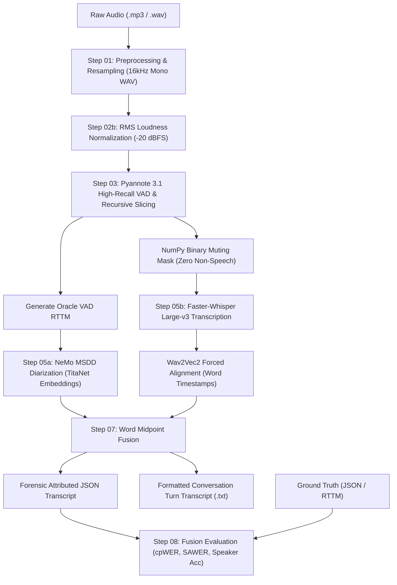

# 02 — Executable Code and Dependency Forensics

## 1. Executive Summary: Codebase Architecture & Key Findings

The repository contains **312 Python files** across five primary layers:
1. **Root Orchestration Scripts (44 scripts):** Iterative prototypes developed throughout the research phases (e.g. `run_production_pipeline.py`, `run_final_hardened_pipeline.py`, `run_stage1.py`, `run_stage4_parallel.py`).
2. **Phase 20 Standalone (`phase20_standalone/`, 21 scripts):** The most mature, fully refactored, and modular implementation of the pipeline in the repository.
3. **Historical Experimental Phases (`experiments/`, 220 scripts):** 22 phase subdirectories containing experimental ablations, diagnostics, audio slicing, and metric logs.
4. **Shared Root Utilities (`scripts/utils/`, 10 scripts):** Logging, audio conversion, config loading, and diagnostic reporting.
5. **Synthetic Benchmarking Suite (`vad_aug_temp/`, 12 scripts):** MS-SNSD synthetic noise augmentation and VAD stress-testing.

**Crucial Forensic Discovery:**
The root scripts contain significant code duplication, legacy hardcoded output directories (`vad_outputs_whisperx`, `asr_outputs_wx`), and ad-hoc `.env` loading from `external/WhisperX-Audio-Intelligence-Platform/.env`. In contrast, **`phase20_standalone/scripts/` represents the verified, decoupled, and hardened state of the art**. It already factors out stage execution, provides mathematical Hungarian/Levenshtein metric evaluation (cpWER, SAWER, Speaker Accuracy, Timeline Accuracy), and includes deterministic reference fallbacks.

---

## 2. Key Execution Entrypoints Inventory

| Entrypoint Script | Location | Role / Stage | Status & Verified Usage | Standalone? |
| :--- | :--- | :--- | :--- | :---: |
| `run_phase20.py` | `phase20_standalone/` | Full Pipeline Orchestrator (Steps 0–10) | **Active / Production Standard** | **Yes** |
| `step00_ground_truth.py` | `phase20_standalone/scripts/` | Text GT to JSON/RTTM Parser | Active | **Yes** |
| `step01_preprocess.py` | `phase20_standalone/scripts/` | Audio Header Repair & Resampling | Active | **Yes** |
| `step02a_deepfilternet.py` | `phase20_standalone/scripts/` | DFN Speech Denoising (Optional) | Active (Ablated) | **Yes** |
| `step02b_loudnorm.py` | `phase20_standalone/scripts/` | EBU R128 Loudness Normalization | Active | **Yes** |
| `step03_vad.py` | `phase20_standalone/scripts/` | Pyannote 3.1 High-Recall VAD Grounding | Active | **Yes** |
| `step04_vad_eval.py` | `phase20_standalone/scripts/` | VAD Evaluation vs Reference | Active | **Yes** |
| `step05a_msdd.py` | `phase20_standalone/scripts/` | NeMo Oracle MSDD Diarization | Active | **Yes** |
| `step05b_whisperx.py` | `phase20_standalone/scripts/` | Faster-Whisper + Wav2Vec2 Alignment | Active | **Yes** |
| `step06a_diar_eval.py` | `phase20_standalone/scripts/` | DER / Purity / Coverage Diarization Eval | Active | **Yes** |
| `step06b_asr_eval.py` | `phase20_standalone/scripts/` | WER / MER / WIL ASR Evaluation | Active | **Yes** |
| `step07_fusion.py` | `phase20_standalone/scripts/` | Word-Level Midpoint Diarization Fusion | Active | **Yes** |
| `step08_fusion_eval.py` | `phase20_standalone/scripts/` | cpWER / SAWER Permutation-Invariant Eval| Active | **Yes** |
| `step09_aggregate_report.py`| `phase20_standalone/scripts/` | Aggregate Markdown & JSON Metrics | Active | **Yes** |
| `step10_compare_phase19.py` | `phase20_standalone/scripts/` | Historical Regression Testing | Active | **Yes** |
| `run_final_hardened_pipeline.py` | Root | Epoch 4 Hardened Prototype | Superseded by Phase 20 | No |
| `run_production_pipeline.py` | Root | Epoch 2/3 Linear Prototype | Superseded by Phase 20 | No |
| `run_stage1.py` | Root | Stage 1 VAD & Preprocessing | Superseded by Phase 20 | No |
| `run_stage4_parallel.py` | Root | WhisperX + Pyannote Parallel | Superseded by Phase 20 | No |
| `run_karen_inference.py` | Root | Karen Dataset Benchmark Runner | Superseded by Phase 20 | No |
| `vad_engine.py` | `scripts/` | Multimodel VAD Orchestrator | Reusable utility | Semi |

---

## 3. Deep Script-by-Script Forensic Analysis

### 3.1 `phase20_standalone/run_phase20.py`
- **What it does:** Master execution pipeline. Takes `--file <stem>` and sequentially executes Steps 00 through 10 as subprocesses.
- **Inputs:** Audio file stem (`bwc`, `traffic_stop`, `karen`), optional `--overwrite`.
- **Outputs:** End-to-end processing artifacts in structured subfolders: `audio/`, `grounding/`, `diarization/`, `transcription/`, `fusion/`, `metrics/`, `reports/`.
- **Imports:** `argparse`, `subprocess`, `sys`, `pathlib`, `common`.
- **Hardcoded Paths:** Sets default environment temp directories `/tmp/marston_phase20_mpl` and `/tmp/marston_phase20_numba`.
- **Environment:** Compatible with Python 3.10–3.12.
- **Independence:** 100% self-contained within `phase20_standalone/`.

### 3.2 `phase20_standalone/scripts/step03_vad.py`
- **What it does:** High-Recall Voice Activity Detection. Runs `pyannote/voice-activity-detection` (Pipeline 3.1) to generate speech probabilities. Extracts raw speech segments, merges micro-gaps (< 300ms), removes short artifacts (< 200ms), and recursively splits long segments (> 30s) using probability minima or RMS energy valleys to satisfy Whisper's 30-second context limit.
- **Inputs:** `repaired_audio` or `normalized_audio` (16kHz WAV).
- **Outputs:** `<name>_<path>_vad.json` containing segmented speech intervals and confidence curves.
- **Fallback Mode:** If Pyannote or PyTorch is unavailable, executes `reference_vad_fallback()` which derives valid VAD segments deterministically from `ground_truth_json` so downstream tests can execute in CI without GPU or HF tokens.

### 3.3 `phase20_standalone/scripts/step05a_msdd.py`
- **What it does:** NeMo Multi-Scale Diarization Decoder (MSDD) diarization with Oracle VAD.
- **Methodology:** Injects Pyannote's VAD segments as an "Oracle" RTTM into NeMo's NeuralDiarizer, forcing MSDD to diarize only validated speech regions. Uses `titanet_large` speaker embeddings with multi-scale sliding windows (1.5s, 1.2s, 1.0s, 0.8s, 0.5s) and `diar_msdd_telephonic` clustering.
- **Inputs:** Audio WAV, Path A VAD JSON.
- **Outputs:** NeMo RTTM file in `diarization/`.
- **Fallback Mode:** Copies reference RTTM if NeMo is not installed, recording `fallback: True` in the stage metadata.

### 3.4 `phase20_standalone/scripts/step05b_whisperx.py`
- **What it does:** ASR transcription and word-level forced alignment.
- **Methodology:** Transcribes VAD speech chunks using Faster-Whisper `large-v3` (`condition_on_previous_text=False` to prevent hallucination loops). Performs phoneme-level forced alignment using Wav2Vec2 (`whisperx.load_align_model("en")`) to obtain precise word start and end timestamps.
- **Inputs:** Normalized audio, Path B VAD JSON.
- **Outputs:** `<name>_aligned_words.json` and raw transcript JSON.
- **Fallback Mode:** Generates uniform word timings from reference JSON if WhisperX is absent.

### 3.5 `phase20_standalone/scripts/step07_fusion.py`
- **What it does:** Word-Level Midpoint Diarization Fusion.
- **Methodology:** Reconciles the ASR timeline and Diarization timeline. For each aligned word, computes its temporal midpoint `t_mid = (start + end) / 2`. Finds the active speaker segment in the NeMo RTTM that contains `t_mid`. If the midpoint falls in a diarization gap, attributes the word to the nearest speaker segment within a tolerance window (0.25s). Groups contiguous words with the same speaker into natural conversational turns.
- **Inputs:** `<name>_aligned_words.json`, NeMo RTTM.
- **Outputs:** `<name>_attributed_words.json` and human-readable `<name>_fusion_transcript.txt`.

### 3.6 Evaluation Suite: Hungarian Permutation-Invariant Metrics (`cpwer.py`, `sawer.py`, `speaker_mapping.py`, `step08_fusion_eval.py`)
- **What it does:** Implements state-of-the-art MeetEval / CHiME-7 DASR evaluation methodologies without requiring external MeetEval dependencies:
  - **Optimal Speaker Mapping:** Solves bipartite minimum-cost matching using Hungarian algorithm (`scipy.optimize.linear_sum_assignment` or local fallback).
  - **cpWER (Concatenated Permutation Word Error Rate):** Concatenates hypothesis and reference words per speaker and evaluates Levenshtein distance across all speaker permutations.
  - **SAWER (Speaker-Attributed Word Error Rate):** Aligns hypothesis words to mapped reference speaker streams.
  - **Timeline Accuracy:** Evaluates 10ms binary active-speaker frame sets.

---

## 4. Pipeline Evolution Across Historical Epochs

```text
+-------------------------------------------------------------------------------+
| Epoch 1 (Phases 1-2): Linear Serial Pipeline (Flawed)                         |
| Raw Audio -> DeepFilterNet Denoising -> WhisperX VAD -> Whisper -> Pyannote   |
| Problem: WhisperX VAD skipped quiet speech. DFN destroyed phonetic acoustics. |
+-------------------------------------------------------------------------------+
                                      |
                                      v
+-------------------------------------------------------------------------------+
| Epoch 2 (Phases 3-5): The Oracle MSDD Grounding Pivot                         |
| Decoupled VAD from Diarization. Pyannote 3.1 VAD injected as Oracle RTTM into |
| NeMo MSDD. Separated noisy field audio into distinct speakers for first time. |
+-------------------------------------------------------------------------------+
                                      |
                                      v
+-------------------------------------------------------------------------------+
| Epoch 3 (Phase 10): Dual-Branch DFN vs Normalized Experiment (Failed)         |
| DFN path for ASR, Normalized path for Diarization.                            |
| Problem: DFN introduced 10-25ms phase shift/temporal drift. Fusion failed.    |
+-------------------------------------------------------------------------------+
                                      |
                                      v
+-------------------------------------------------------------------------------+
| Epoch 4 (Phases 18-20, phase20_standalone): Hardened Master Grounding         |
| 1. RMS Normalization (-20 dBFS) on unified single audio stream.              |
| 2. Pyannote 3.1 High-Recall VAD with Recursive Slicing (< 30s).              |
| 3. NumPy Binary Muting Mask: Zeros out sirens/non-speech before ASR.          |
| 4. Faster-Whisper Large-v3 (condition_on_previous_text=False).                |
| 5. Wav2Vec2 Word-Level Forced Alignment.                                      |
| 6. NeMo Oracle MSDD Diarization with TitaNet-Large Embeddings.                |
| 7. Word Midpoint Fusion & Permutation-Invariant Evaluation.                   |
+-------------------------------------------------------------------------------+
```

---

## 5. Execution Dependency Graph for Standalone Pipeline



---

## 6. Hardcoded Paths and Root Coupling Inventory

Our AST and regular expression scan identified the following path issues:

1. **Temporary Cache Paths in `phase20_standalone`:**
   - `phase20_standalone/run_phase20.py` (Lines 18-19):
     `env.setdefault("MPLCONFIGDIR", "/tmp/marston_phase20_mpl")`
     `env.setdefault("NUMBA_CACHE_DIR", "/tmp/marston_phase20_numba")`
   - *Assessment:* Non-portable on Windows (creates `C:\tmp\...`). Must be refactored in `app/` to use Python’s `tempfile.gettempdir()`.
2. **Coupled Root Scripts:**
   - `run_asr.py`, `run_diarization.py`, `run_final_hardened_pipeline.py`:
     Directly import from `PROJECT_ROOT / "external" / "WhisperX-Audio-Intelligence-Platform"`.
   - `run_karen_audit.py`:
     Directly references `Path("experiments/karen_11A_audit/...")`.
3. **Flat Output Folders at Root:**
   Root scripts dump output directly to `asr_outputs_wx`, `vad_outputs_whisperx`, `diarization_outputs_wx`. These folders contain intermediate research dumps that must NOT be part of `app/`.

---

## 7. Code Duplication and Obsolete Scripts

### 7.1 Superseded or Duplicate Root Scripts

| Script Name | Duplicate Of / Superseded By | Reason for Deprecation |
| :--- | :--- | :--- |
| `run_production_pipeline.py` | `phase20_standalone/run_phase20.py` | Older serial pipeline lacking Oracle MSDD and mid-point fusion. |
| `run_final_hardened_pipeline.py` | `phase20_standalone/run_phase20.py` | Experimental precursor to Phase 20 with hardcoded root paths. |
| `run_stage1.py` & `run_stage1_whisperx.py` | `phase20_standalone/scripts/step03_vad.py` | Pre-Phase 10 VAD scripts with legacy parameters. |
| `evaluate_asr.py` & `evaluate_asr_improved.py`| `phase20_standalone/scripts/step06b_asr_eval.py`| Does not support permutation-invariant evaluation. |
| `evaluate_diarization.py` & `..._improved.py` | `phase20_standalone/scripts/step06a_diar_eval.py`| Lacks collar tolerance and Hungarian mapping. |
| `append_part2.py`, `append_part3.py`, `append_part4.py` | None (One-off) | Utility scripts used to append text to Markdown reports. Obsolete. |
| `fix_karen_gt.py`, `parse_karen_gt.py`, `truncate_karen.py` | `phase20_standalone/scripts/step00_ground_truth.py` | One-off regex scripts for historical Karen transcript fixes. |

---

## 8. Recommended Reusable Components for `app/`

The core engine for `app/` should be constructed exclusively by adapting the modules from `phase20_standalone/scripts/`:

1. **`phase20_standalone/scripts/step01_preprocess.py` & `step02b_loudnorm.py`:**
   -> Adapt into `app/engine/preprocessing/audio.py` (FFmpeg-based 16kHz mono conversion and EBU R128 loudness normalization).
2. **`phase20_standalone/scripts/step03_vad.py`:**
   -> Adapt into `app/engine/vad/pyannote_vad.py` (High-recall VAD, gap merging, micro-segment suppression, recursive chunk slicing).
3. **`phase20_standalone/scripts/step05b_whisperx.py`:**
   -> Adapt into `app/engine/asr/whisper_engine.py` (Faster-Whisper large-v3 transcription + Wav2Vec2 forced alignment).
4. **`phase20_standalone/scripts/step05a_msdd.py`:**
   -> Adapt into `app/engine/diarization/nemo_msdd.py` (Oracle VAD injection, TitaNet embeddings, MSDD clustering).
5. **`phase20_standalone/scripts/step07_fusion.py`:**
   -> Adapt into `app/engine/fusion/word_midpoint.py` (Temporal midpoint word-to-speaker attribution and conversational turn grouping).
6. **`phase20_standalone/scripts/speaker_mapping.py`, `cpwer.py`, `sawer.py`, `timeline_metrics.py`:**
   -> Adapt into `app/engine/evaluation/metrics.py` (Permutation-invariant Hungarian solver, cpWER, SAWER, Speaker Accuracy, DER).
7. **`scripts/utils/logger.py` & `scripts/utils/device.py`:**
   -> Adapt into `app/backend/core/logging.py` and `app/engine/core/device.py`.
