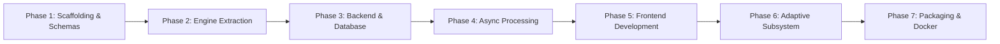

# 08 — Phased Migration and Implementation Roadmap

## 1. Migration Strategy and Guardrails

To migrate from the current experimental research structure into the standalone `<PROJECT_ROOT>/app/` application cleanly and safely:
1. **Zero Impact on Research Tree:** No existing file in `experiments/`, `phase20_standalone/`, `raw_audio/`, or `ground_truth/` will be deleted, moved, or altered.
2. **Selective Extraction with Provenance:** Only verified components from `phase20_standalone/scripts/` will be extracted, refactored, and tested within `app/`.
3. **Mock-First Development:** The entire backend, database, API, and frontend will be built to operate with deterministic mock engines first, enabling rapid test cycles before binding heavy GPU models.

---

## 2. Phased Implementation Roadmap

---

### Phase 1: App Foundation, Packaging, and Schemas
- **Objective:** Establish the clean standalone `app/` directory boundary, dependency specifications, and canonical Pydantic v2 data models.
- **Files to Create:**
  - `app/pyproject.toml`, `app/README.md`, `app/.env.example`, `app/.gitignore`
  - `app/engine/schemas/audio.py`, `app/engine/schemas/transcript.py`, `app/engine/schemas/results.py`
  - `app/configs/default_config.yaml`
- **Files to Reuse / Adapt:**
  - Adapt data structures from `phase20_standalone/scripts/common.py`.
- **Dependencies:** `pydantic>=2.6.0`, `pyyaml`.
- **Risks:** Schema mismatch with legacy JSON formats.
- **Acceptance Criteria:** Pydantic models cleanly parse existing `phase20_standalone/outputs/*.json`.
- **Tests Required:** `pytest app/tests/test_schemas.py`.

---

### Phase 2: Processing Engine Extraction & Modularization
- **Objective:** Extract the verified Phase 20 algorithms into decoupled, callable Python engine classes.
- **Files to Create:**
  - `app/engine/preprocessing/audio.py`
  - `app/engine/vad/pyannote_vad.py`, `app/engine/vad/recursive_slicer.py`
  - `app/engine/asr/whisper_engine.py`
  - `app/engine/alignment/wav2vec2_aligner.py`
  - `app/engine/diarization/nemo_msdd.py`
  - `app/engine/fusion/word_midpoint.py`
  - `app/engine/evaluation/metrics.py`
  - `app/engine/pipeline/orchestrator.py`
  - `app/engine/fallbacks/mock_engine.py`
- **Files to Adapt:**
  - `phase20_standalone/scripts/step01_preprocess.py`
  - `phase20_standalone/scripts/step02b_loudnorm.py`
  - `phase20_standalone/scripts/step03_vad.py`
  - `phase20_standalone/scripts/step05a_msdd.py`
  - `phase20_standalone/scripts/step05b_whisperx.py`
  - `phase20_standalone/scripts/step07_fusion.py`
  - `phase20_standalone/scripts/cpwer.py`, `sawer.py`, `speaker_mapping.py`, `timeline_metrics.py`
- **Dependencies:** `soundfile`, `librosa`, `scipy`, `numpy` (and optional `engine` deps).
- **Risks:** Numerical regressions during refactoring.
- **Acceptance Criteria:** Pipeline orchestrator reproduces identical cpWER and SAWER on `bwc` when executed with full weights, and completes without errors using mock fallbacks.
- **Tests Required:** `pytest app/engine/tests/`.

---

### Phase 3: Backend API and Persistent Data Layer
- **Objective:** Build the FastAPI application server, SQLAlchemy models, and SQLite/PostgreSQL persistence.
- **Files to Create:**
  - `app/backend/app/main.py`, `app/backend/app/config.py`
  - `app/backend/app/core/logging.py`, `security.py`, `exceptions.py`
  - `app/backend/app/database/session.py`, `base.py`
  - `app/backend/app/models/recording.py`, `job.py`, `transcript.py`, `revision.py`
  - `app/backend/app/services/audio_service.py`, `transcript_service.py`
  - `app/backend/app/api/v1/router.py`, `endpoints/audio.py`, `endpoints/transcripts.py`
  - `app/scripts/init_db.py`
- **Files to Reuse:**
  - `scripts/utils/logger.py` -> `app/backend/core/logging.py`.
- **Dependencies:** `fastapi`, `uvicorn`, `sqlalchemy>=2.0`, `alembic`, `pydantic-settings`.
- **Risks:** Large file upload timeouts.
- **Acceptance Criteria:** Successful file upload, SHA-256 deduplication, database record creation, and transcript retrieval via REST endpoints.
- **Tests Required:** `pytest app/backend/tests/test_api/`.

---

### Phase 4: Asynchronous Task Processing & Job State Machine
- **Objective:** Decouple heavy inference execution from HTTP request/response loops using an asynchronous worker queue.
- **Files to Create:**
  - `app/backend/app/workers/celery_app.py`, `app/backend/app/workers/tasks.py`
  - `app/backend/app/services/job_service.py`
  - `app/backend/app/api/v1/endpoints/jobs.py`
- **Dependencies:** `celery`, `redis` (with FastAPI `BackgroundTasks` fallback for local dev).
- **Risks:** Worker crashes due to GPU Out-Of-Memory (OOM).
- **Acceptance Criteria:** Upload returns `202 Accepted` with `job_id`; polling endpoint returns `queued` -> `processing (stage: VAD, 25%)` -> `completed`.
- **Tests Required:** `pytest app/backend/tests/test_workers/`.

---

### Phase 5: Modern Web Frontend
- **Objective:** Deliver an interactive React/Vite web UI for recording upload, waveform audio playback, word-synchronized transcript display, and speaker reassignment.
- **Files to Create:**
  - `app/frontend/` (Vite, React 18, TypeScript, Tailwind CSS)
  - `src/components/AudioPlayer/Waveform.tsx` (using Wavesurfer.js)
  - `src/components/TranscriptTimeline/TurnRow.tsx`, `WordSpan.tsx`
  - `src/pages/DashboardPage.tsx`, `AnalysisPage.tsx`, `EvaluationPage.tsx`
- **Dependencies:** Node.js 18+, React, TypeScript, Wavesurfer.js, Lucide-React.
- **Risks:** Sub-millisecond playback lag with long transcripts.
- **Acceptance Criteria:** Seamless playback with active word highlighting and instant speaker reassignment in UI.
- **Tests Required:** `npm run test` and `npm run build`.

---

### Phase 6: Adaptive Intelligence Layer
- **Objective:** Provide self-improving conversational intelligence via dynamic vocabulary boosting, user correction tracking, and reliability-aware strategy selection.
- **Files to Create:**
  - `app/adaptive/vocabulary/term_extractor.py`, `prompt_booster.py`
  - `app/adaptive/feedback/diff_tracker.py`, `error_categorizer.py`
  - `app/adaptive/configuration/auto_tuner.py`
  - `app/backend/app/api/v1/endpoints/adaptive.py`
- **Dependencies:** `rapidfuzz`, `scikit-learn`.
- **Risks:** Over-biasing ASR with irrelevant vocabulary prompts.
- **Acceptance Criteria:** Verified reduction in WER on domain-specific terminology after user corrections are registered.
- **Tests Required:** `pytest app/adaptive/tests/`.

---

### Phase 7: Containerization & Independence Verification
- **Objective:** Package the entire system into reproducible Docker containers and execute the physical isolation test.
- **Files to Create:**
  - `app/Dockerfile` (Multi-stage CUDA 12.4 + cuDNN 9 image)
  - `app/docker-compose.yml` (App, Worker, Postgres, Redis, Frontend)
  - `app/scripts/run_standalone_test.sh`
- **Dependencies:** Docker, Docker Compose, NVIDIA Container Toolkit.
- **Risks:** Discrepancies between host CUDA drivers and container CUDA runtime.
- **Acceptance Criteria:** `app/` builds cleanly and runs in an isolated directory (`/tmp/standalone_app_test`) with 100% test pass rate.
- **Tests Required:** Full 8-tier verification suite (`app/tests/`).

---

## 3. Critical Architectural Decisions to Align on with User

1. **Local vs Cloud Task Queue:**
   - *Option A:* Built-in FastAPI `BackgroundTasks` + SQLite (Simpler, zero infrastructure, single process).
   - *Option B (Recommended):* Celery + Redis + PostgreSQL via Docker Compose (Enterprise scale, robust crash recovery, independent worker scaling).
2. **Pretrained Model Weight Management:**
   - *Option A:* Download on-demand during first run (Requires runtime internet & HF token).
   - *Option B (Recommended):* Pre-baked model volume cache mount or explicit `download_models.py` pre-cache step before deployment.
3. **Benchmark Audio Ingestion:**
   - *Policy:* Benchmark audio (`raw_audio/`) should remain outside `app/` in git tracking, but a dedicated CLI command (`python -m engine.evaluation.benchmark --audio-dir ../raw_audio`) will allow running full evaluations against it.
