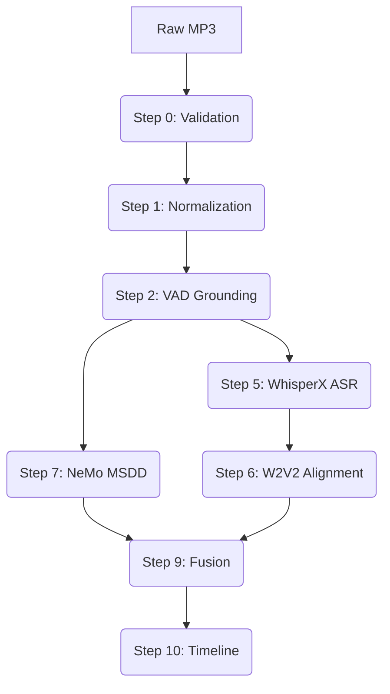

# Phase 12 Architecture: Unbiased Generalization Pipeline

The Phase 12 architecture is a realization of the "Hardened Production Pipeline" designed for zero-knowledge inference on unseen audio. It prioritizes robustness against input corruption and relies on automated speaker discovery rather than oracle metadata.

## System Block Diagram

1.  **Ingestion & Validation (Step 0-1)**
    - `FFprobe` header analysis vs. `Librosa` raw decode.
    - `Loudnorm` normalization: `I=-20`, `TP=-1.5`, `LRA=11`.
    - Sample Rate: 16kHz Mono (standardized for NeMo/WhisperX).

2.  **Voice Activity Detection (Step 2-3)**
    - **Model:** `pyannote/voice-activity-detection` (HuggingFace Asset).
    - **Post-processing:** 150ms gap merging to stabilize segments for ASR.
    - **Output:** Binary RTTM grounding for MSDD.

3.  **Acoustic Processing (Step 4-6)**
    - **Muting:** Grounded-audio generation (preserving only speech regions) to reduce noise-floor artifacts in ASR.
    - **ASR:** WhisperX `large-v3` inference on individual VAD slices.
    - **Alignment:** Wav2Vec2-based forced alignment for word-level timestamps.

4.  **Neural Diarization (Step 7-8)**
    - **Architecture:** NeMo Multiscale Segmentation and Diarization (MSDD).
    - **Embeddings:** `titanet_large` with multiscale windows (1.5s down to 0.5s).
    - **Clustering:** Sparse search volume (30) with `oracle_num_speakers=False`.
    - **Inference Mode:** Telephonic MSDD model adapted for BWC dynamics.

5.  **Information Fusion (Step 9-10)**
    - **Mechanism:** Maximum Overlap Word Fusion.
    - **Logic:** Each word from WhisperX is mapped to the MSDD speaker who has the highest temporal overlap with that word's aligned interval.
    - **Timeline Generation:** Majority-vote segment attribution.

## Key Hyper-parameters

| Component | Parameter | Value | Rationale |
| :--- | :--- | :--- | :--- |
| **Normalization** | Target LUFS | -20 | Standard for BWC clarity. |
| **VAD** | Merge Gap | 0.15s | Prevents fragmentation in conversational turns. |
| **ASR** | Condition On Prev | False | Prevents hallucination loops on truncated audio. |
| **Diarization** | Multiscale Weights | [1, 2, 3, 3, 3] | Heavy weighting on fine-grained windows for overlap. |
| **Diarization** | RP Threshold | 0.25 | Balances recall/precision in clustering. |

## Data Flow

