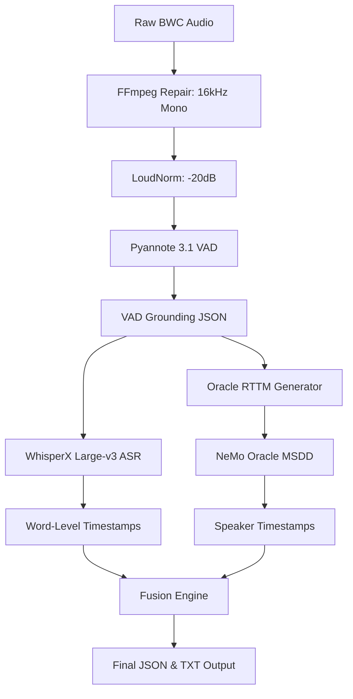

# Technical Architecture: Phase 14 (BWC Fix)

## System Overview
The Phase 14 architecture is a decoupled, multi-stage pipeline designed to maximize the signal-to-noise ratio for both ASR and Diarization. Unlike end-to-end models, this modular approach allows for "Master Grounding," where high-recall VAD informs subsequent neural processes.

## Architecture Diagram

## Modular Deep Dive

### 1. Pre-Processing (Step 0 & 1)
- **Downsampling:** Standardizes audio to 16,000 Hz, the required sample rate for NeMo and WhisperX models.
- **Normalization:** Uses `loudnorm` (EBU R128) to ensure consistent amplitude. This is critical for the TitaNet embedding extractor in Step 5, as it prevents loudness-based bias in speaker clustering.

### 2. Master Grounding (Step 2 & 3)
- **Model:** Pyannote 3.1 Voice Activity Detection.
- **Logic:** Identifies speech vs. non-speech boundaries with high recall.
- **Oracle Injection:** Instead of allowing the diarizer to compute its own VAD (which often fails in noisy BWC environments), the Pyannote boundaries are "injected" as an oracle proposal into the NeMo MSDD manifest.

### 3. Transcription & Alignment (Step 4)
- **Model:** Whisper Large-v3.
- **Alignment:** Wav2Vec 2.0.
- **Constraint:** Transcription is restricted to the VAD-grounded segments, reducing hallucinations during periods of silence or radio static.

### 4. Neural Diarization (Step 5)
- **Model:** Multi-Scale Diarization Decoder (MSDD).
- **Embeddings:** TitaNet-Large.
- **Configuration:** Telephonic model variant (`diar_msdd_telephonic`) selected for its robustness to band-limited forensic audio. Uses multiscale windows ([1.5, 1.2, 1.0, 0.8, 0.5]) to capture both context and fine-grained transitions.

### 5. Fusion & Attribution (Step 6)
- **Algorithm:** Heuristic assignment.
- **Conflict Resolution:** For each word, the fusion engine calculates temporal overlap with MSDD speaker segments. If no direct overlap exists, it falls back to a nearest-neighbor search within a 500ms tolerance window.
