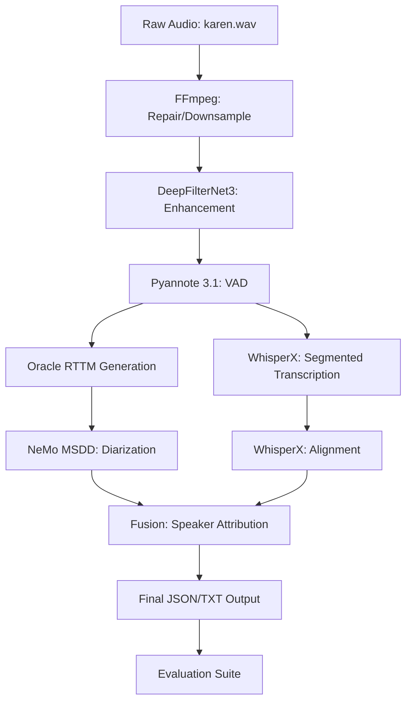

# Pipeline Flow: Phase 16

This document outlines the sequential data flow and transformation stages in the Phase 16 (No-Norm + DFN) pipeline.

## 1. Input & Repair
- **Source:** `raw_audio/karen.wav`.
- **Transformation:** `karen_repaired.wav` (16kHz, Mono).
- **Note:** No loudness normalization is applied.

## 2. Enhancement
- **Source:** `karen_repaired.wav`.
- **Transformation:** `karen_dfn.wav`.
- **Action:** DeepFilterNet3 removes background noise and enhances speech clarity.

## 3. Grounding (VAD)
- **Source:** `karen_dfn.wav`.
- **Output:** `karen_grounding.json`.
- **Significance:** These segments define the "windows" for all subsequent ASR and Diarization tasks.

## 4. Dual-Branch Processing
- **Branch A (ASR):**
  - Slices `karen_dfn.wav` into VAD segments.
  - Transcribes with Whisper v3 Large.
  - Aligns with WhisperX to produce `aligned_words.json`.
- **Branch B (Diarization):**
  - Uses `karen_oracle.rttm` (derived from VAD) to guide MSDD.
  - Generates `karen_msdd.rttm` with specific speaker IDs.

## 5. Fusion & Serialization
- **Input:** `aligned_words.json` + `karen_msdd.rttm`.
- **Logic:** Temporal overlap mapping.
- **Output:**
  - `karen_final.json`: Comprehensive data structure with word-level metadata.
  - `karen_final.txt`: Human-readable transcript with speaker labels and timestamps.

## 6. Evaluation
- Compares system outputs against ground truth (`ground_truth_json/karen.json` and `ground_truth/karen.txt`).
- Produces metric CSVs in `reports/` and diagnostic files in `diagnostics/`.
