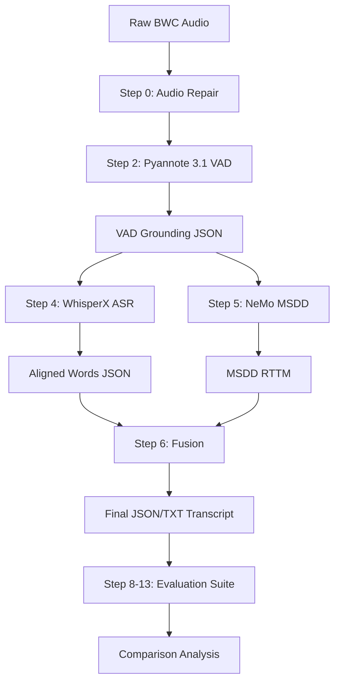

# Pipeline Flow: Phase 17

## Data Flow Diagram (Conceptual)

## Detailed Execution Flow

### Phase 1: Signal Preparation
1. **Input:** `raw_audio/bwc.wav`.
2. **Process:** FFmpeg downsamples to 16kHz and converts to mono.
3. **Output:** `experiments/phase17_bwc_no_norm/audio/bwc_repaired.wav`.
*Note: The traditional Phase 1 (Normalization) is explicitly skipped.*

### Phase 2: Feature Extraction & Grounding
1. **Input:** Repaired WAV.
2. **Process:** Pyannote 3.1 runs inference to detect speech segments.
3. **Output:** `grounding/bwc_grounding.json`. This serves as the temporal "anchor" for all subsequent steps.

### Phase 3: Parallel Inference
- **ASR Path:** WhisperX uses the grounding JSON to focus transcription efforts, ensuring words are only generated where speech was detected.
- **Diarization Path:** NeMo MSDD uses the grounding JSON as its VAD input, performing speaker clustering and multi-scale refinement on the identified segments.

### Phase 4: Word-Level Attribution (Fusion)
1. **Logic:** The `step6_fusion.py` script iterates through every word generated by WhisperX.
2. **Matching:** For each word, it checks which speaker turn in the MSDD RTTM overlaps with the word's start/end time.
3. **Refinement:** Words are grouped into sentences/paragraphs based on speaker identity and silence thresholds.

### Phase 5: Verification & Comparison
1. **Scoring:** The pipeline outputs are compared against `ground_truth/bwc.txt` and `ground_truth_rttm/bwc.rttm`.
2. **Reporting:** Metrics are aggregated into CSV files in `reports/`.
3. **Finalization:** Phase 17 metrics are joined with Phase 11A baseline metrics for delta analysis.
